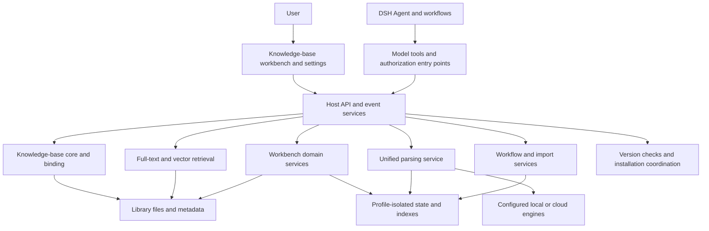

# Plugin Design and Development Record

[English](PROJECT-RECORD.en.md) · [简体中文](PROJECT-RECORD.md)

<!-- project-record-version: 2.3.0 -->

**Implementation covered: 2.3.0 (stable) · Updated: 2026-10-31 · Maintenance: review this record alongside the source with every release.**

This long-term record is for users, maintainers, and future contributors. It explains why the product is built this way, what it can currently do, how its features fit together, where data is stored, and what may come next. “Implemented” refers to source code in this repository. Roadmap items are future directions, not features already delivered. The installed version and build ID must be checked in the client and the corresponding release manifest.

See the [workbench guide](WORKBENCH.en.md) for usage, [release notes](RELEASE.en.md) for changes in each release, and [versioning policy](VERSIONING.en.md) for version comparisons. This record explains the product as a whole; release notes are not an architecture document.

## 2.3.0 stable: inbox, index privacy, and unified desktop workbench

### Unified desktop UI (2026-10-30)

The [Figma design](https://www.figma.com/design/9O89rqsKJ8ufkiPQGhqGTn) uses editable components and text, and covers the inbox, host settings, and dark theme. `src/client/knowledge-ui.css` is the source of shared styles. `sync-workbench-client.py` embeds it into `index.js`, while `sync-workbench-build.py` includes it in the build fingerprint. After editing the style source or `workbench-ui.js`, run the synchronization steps; do not change only generated fragments.

Inbox cards and archived-item details share a keyboard-operable **Exclude from index** switch. Related actions remain disabled until the service confirms success; on failure, the backend state is retained. After an archived item is moved, the view refreshes at its new path and keeps the details open. A selected item is restored only when the library is the same and view permissions have not changed. Host settings reuse the existing service form through category navigation. Preference saves still validate `kbId` and `revision`, and switching retrieval categories does not discard unsaved fields. This work covers desktop design only; it adds no mobile adaptation.

Interaction checks in Edge used a fictional library and host-service substitutes. No personal materials were accessed. A formal DSH installation and real model-based filing were not verified. This UI shipped in the stable 2.3.0 release; later changes should go into a new version rather than replace the existing release package.

### Inbox organization, index exclusion, and parsing records (2026-10-29)

Added `index-policy.js` and `index-policy-service.js` to unify material ownership, exclusion policy, and file-move progress. They are connected to the core full-text index, hybrid retrieval, relationship index, map, parsing, and archive entry points. Exclusion and restoration both update relationship links. Excluded materials and their registered derivatives are stored in a separate **Excluded from index** section. The old vector manifest lacks complete source ownership, so changing state clears the old generation and then rebuilds vectors for allowed materials. `kb_inbox` supplies the organization queue without depending on search indexes. The source field on `kb_record` determines how archived items inherit rules; completion explicitly registers the archive result.

Validation used fictional materials and simulated local Embedding and OCR responses. It covered clearing and restoring full-text/vector indexes and two-way relationships, source inheritance, parsed-file visibility, batch changes, refusing conflicting overwrites, and retry after failure. Browser checks covered individual and batch operations. No personal-library migration, production-host installation, or real model-based organization was performed.

The same stable release also fixed OCR/ASR submissions being incorrectly rejected for knowledge-base Agents in standard desktop hosts. Without H1, authorization checks a live knowledge-base root session or current grant; explicit isolation requirements still require H1, and an enabled but unready H1 never falls back. A knowledge flow running in a separate workspace can parse originals in the currently bound library. Submission details preserve the actual rejection code and reason and link to related task details and result previews. Six targeted authorization checks passed, including submission and result retrieval for fictional materials through simulated OCR/ASR services; no real model or production DSH installation was used.

The inbox now saves files immediately after multi-file selection or drag-and-drop, and independently scans inbox contents, including files added manually. Existing identity, permission, upload-size, and duplicate checks remain. The backend provides a permanent `builtin-inbox-organize` workflow that cannot be changed, disabled, or deleted. The inbox and workflow page reuse the new-session execution entry point. Users select a model; reasoning is fixed at High. The inbox saves the model choice locally in the browser per `kbId`. The model must still be available and support High, and model selection must succeed before the organization prompt is sent. This workflow uses session execution so a background route cannot bypass the High requirement. Backend and browser interaction checks used a fictional library; no model was called in a real host.

### Session-directory sidebar entry (2026-10-28)

Added a **Knowledge Base** row in the left session directory, alongside plugins and scheduled tasks (order 20). Clicking it opens the same workbench. The top tab remains; both entries use the same UI, data, and settings, without registering a second copy.

The pairing rule comes from the host: `sidebar.panellist` row `id` must match the `main` keyed-slot `key`, and `key` is required. The host renders the row; the plugin supplies only an icon component that receives `{ size, active }`. Rows are sorted by `order` (plugins 0, scheduled tasks 10), and labels use `resolveSlotLabel(label) ?? id`. An unpaired row throws without changing the current selection, so this change registers the row and panel together. Host-internal icons are not used; the plugin supplies an SVG whose stroke uses `currentColor` and follows the theme.

Targeted checks and a same-layer mirror probe verified row/panel pairing, label, order, and icon attributes. A browser tool was unavailable, so actual rendering inside the host was not observed. The probe could mirror only the rules read from the host; the definition of `resolveSlotLabel` is outside the host package and was modeled from the row semantics.

## 2.2.0–2.2.1: foundational stability and workflow model selection (2026-10-27)

### Execution model for custom workflows

Workflow definitions gained an optional `execution` field containing `provider`, `model`, and `reasoningEffort`. Older workflows leave it empty and continue to use the previous default route. The editor reads configured models and their exact reasoning levels from the host LLM service; changing the model clears the old reasoning level. **Run now** opens an options panel, and a one-run override does not change the saved definition. A new session is routed through the host's `modelDirectories` before the task is sent; on failure, the error is retained and nothing is sent. Background step-by-step delegation uses the complete saved route too, without mixing reasoning or output parameters from another model.

Synthetic materials and session checks covered saving, reloading, a one-run override, routing order, and blocking after failure. The change was not installed in a production DSH host and no real model was called. The 2.2.1 stable package, manifest, and download entry were updated for the release.

### Less repeated work and foundational stability

Retains 2.1.5 exact retrieval, chunking, Float32 shards, directory format, and question-answer protocol. The base JSON index uses a budgeted cache keyed by a high-precision file fingerprint. Repeated requests reuse parsing and integrity checks; external rewrites invalidate the cache. Original text and line positions are reused within a request, with chunked decoding and streaming summaries. Forensic text is not reused across requests.

Consumers share a watcher for the same root directory. Foreground queries and background maintenance share resource scheduling; background tasks yield at batch boundaries. Unchanged relationship scans after restart do not rewrite the snapshot. Large derived JSON is written in segments to a temporary file, synced, and rechecked before publication. A failure preserves the previous valid file. Later commits remove this module's temporary files only after confirming that the writing process has exited. Temporary disk-space and permission errors use backoff and automatic rechecks. Identity mismatches and abnormal deletions remain protected. Fixed omissions in source folding caused by differences between Windows short paths and real paths.

No runtime dependencies, settings, or manual index migrations were added. This does not introduce SQLite, ANN, a predictor, or a new model. Existing JSON parsing and exact vector scans still have scale limits. The package, update manifest, and download entry were synchronized to 2.2.0. See the [optimization record](EXISTING-FRAMEWORK-OPTIMIZATION.en.md) for benchmarks, validation, and limits.

## 2.1.1–2.1.5: workbench, updates, and retrieval improvements (2026-10-23–2026-10-26)

### Exact retrieval in the existing framework for large libraries (2.1.5)

- Reuses line positions for long documents and retains every candidate needed for the original exact ranking. Large vector working sets are scanned in windows, with full scoring and checksum validation.
- Adds retention budgets for body, chunk, and manifest caches; reuses unchanged manifests; improves scope filtering, batch generation of index inputs, concurrency limits, and cancellation of active queries.
- Accelerates existing name-substring suggestions and fixes relationship refreshes returning a stale file list after waiting on an earlier scan.
- Settings show the version only; the build ID remains in internal update and integrity checks.
- Keeps the model, chunk version, disk index, and question-answer protocol. No compatible index rebuild is required. SQLite / USearch and the new evidence protocol were deferred and are not in this release.

Synthetic comparison: for 20,000 1,024-dimensional vectors, warm-query median fell from about 553 ms to 180 ms, and peak RSS in separate processes fell from about 418 MB to 201 MB. Ranking and coverage were identical. All 71 related checks passed. Full vector reads remain 81.92 MB per query, and the question-answer context budget is unchanged. See the [optimization and validation record](EXISTING-FRAMEWORK-OPTIMIZATION.en.md).

### Background updates and completion state (2.1.4)

Stable releases eligible for automatic installation within the same major version no longer appear in a pre-update choice dialog. Manual entry points remain for major-version changes, preview channels, and hosts without a client installation interface. After the host build and client version both match, shared version state is refreshed, old requests are invalidated, and a new check starts. This prevents a late result from restoring an outdated available-update notice. Stable patch releases do not show release notes; minor and major upgrades continue to combine unread content.

All 26 targeted checks passed for installation recovery, silent notices, completion state, late checks, and read-state persistence. Version, package, release manifest, and website entry were synchronized to 2.1.4.

### Responsiveness and retrieval performance (2.1.3)

The workbench continues to use SSE, coalescing material-change refreshes over 200 ms. Visible pages refresh every 60 seconds as a fallback, pause while hidden, and refresh on return to visibility or focus. The file watcher can notify the workbench even when retrieval is disabled. The server invalidates snapshots before broadcasting, preventing an older concurrent scan from restoring stale data. Relationship indexing reports completion/failure events; progress is polled only while an update is active.

The main thread reuses chunks and input hashes. The worker retains a material index per library, permission, configuration, and directory version, and receives only additions, modifications, and removals when materials change. Term frequency, length, document frequency, and postings are reused. Short terms, quoted phrases, and cross-chunk matches remain supported. Estimated budgets are 128 MiB for the main-thread directory and 128 MiB for the worker lexical directory; the vector-buffer LRU is capped at 64 MiB. Actual object-heap use can be higher. Exceeding the budget falls back to full computation rather than reducing coverage.

Each query checks shard file identity, size, and mtime/ctime, then continues per-vector checksum, bounds, and finite-value checks. A build opens and syncs each shard per batch; it atomically commits the manifest only after every sync and cancellation/configuration check succeeds. Old generations and retry after failure are retained. Traces add phase timings, cache counts, and byte counts without adding query text, document bodies, paths, or keys.

For 20,000 synthetic single-chunk materials, worker warm-query p50 fell from about 109 ms to 17 ms and p95 from about 129 ms to 40 ms; cold queries became slightly slower. This does not predict real libraries or whole-interface speed. Targeted regressions and a browser refresh spot check passed. Parallel scanning remained a later, measurement-driven option. Source, client version, release notes, guide, website entry, package, and release digest were synchronized to 2.1.3. See the [performance record](PERFORMANCE.en.md) for conditions and limits.

### Full-screen relationship canvas (2.1.2)

The graph gained **Full-screen canvas / Exit full screen**, filling the application window with the graph and relationship list. The canvas adjusts to its actual aspect ratio to reduce unused horizontal space. Zoom, drag, fit, and node details remain available. Esc exits full screen first; switching tabs or opening link checks closes it automatically. Full-screen state is not persisted.

The source is `workbench-ui.js`, which the synchronization script embeds into `index.js`. `workbench-relations.js`, `workbench-features.js`, and `workbench-theme.css` are historical split copies, not current UI build inputs. New same-version builds in the delivery directory were unified as 2.1.2 for this stable release. Source, package documentation, website, package, and digest manifest were updated together. The source build passed a synthetic-host browser check; the repackaged build received targeted regressions and release-consistency checks. Full-screen positioning can still be affected by styles on host ancestor elements. Public commits exclude local runtime logs, screenshots, and knowledge-base materials.

### Inbox and release-entry maintenance (2.1.1)

The current entry recommends stable 2.1.1. Preview packages superseded by stable and their download copies were removed. The preview manifest uses `active:false` to indicate that no preview is available. The updater accepts an empty preview channel and filters old mirror previews behind the stable version while retaining the ability to publish a new preview later. Website version, installation guide, and links were synchronized to 2.1.1. Historical release notes remain as development records.

#### Inbox and scrolling maintenance (2026-10-23)

The inbox reuses the existing DeleteFile and `trash.move` two-step confirmation flow; after the original is moved to Trash, the list refreshes and restore remains available. Workbench height is computed from remaining window space to avoid a blank view when the host mounts a parent at zero height. Ancestor scroll-position resets were removed, natural scroll chaining was retained, and space for the host composer is reserved at the bottom of details while observing composer mount and size changes. Fictional-library checks covered deleting a capture original after deleting its note, zero-height parents, desktop and narrow screens, and a short preview at the boundary. No real knowledge-base material, device screenshot, or runtime log was added to release artifacts.

## 2.1.0: hybrid retrieval and reliability maintenance (2026-10-22)

User search and citation-based Q&A now use unified full-text/vector retrieval, with structural chunking, one round of bidirectional local supplementation, RRF, optional general-purpose reranking, and source-context expansion. Settings include SiliconFlow BGE-M3 and generic Embedding/Rerank APIs; saving and enabling starts incremental indexing. Space is estimated but no total quota is enforced. Vectors are stored in Float32 binary shards. Sections and chunks retain source locations without storing another copy of chunk text. Implementation entry points are `retrieval.js`, `retrieval-chunks.js`, `retrieval-api.js`, and `retrieval-worker.js`. See the [retrieval guide](RETRIEVAL.en.md). The rest of this record retains earlier core-index and compatibility-interface notes; current user-facing retrieval is described here and in the guide.

### Reliability and upgrade maintenance

The persistent retrieval worker, content-fingerprint tokenization cache, and merging of simultaneous in-flight vector queries do not cache final answers. Candidate sets, evidence ranges, permissions, and version checks remain. The new Q&A protocol does not resend a full answer by default; at turn end it checks citations and may request one targeted correction. `.kbmeta` records mechanism versions and fingerprints for managed files. Custom files are preserved and differences are exposed. Dynamic-memory reinjection fixes are provided as a separate `memory-evolve` patch and do not modify the host core.

### Stable release record (2026-10-22)

The stable release was first merged to `main` in [PR #25](https://github.com/KingsleyAsher/Personal-Knowledge-Base/pull/25) and published as a GitHub Release: [`v2.1.0`](https://github.com/KingsleyAsher/Personal-Knowledge-Base/releases/tag/v2.1.0). Initial release commit: `bf41c52c088495596c619af30b38a4a4bc43a3e1`. [PR #26](https://github.com/KingsleyAsher/Personal-Knowledge-Base/pull/26) then synchronized release notes, package documentation, installer, website download copy, and digest manifest to `main`, merged as `5abc0bbfd37162e91343906aa761a37ea590639f`. The build ID stayed `37b7ff660806754d` because the synchronization changed no executable build files. The current package byte count, SHA-256, and per-file inventory are authoritative in [`release-manifest.json`](release-manifest.json). The maintainer did not install the stable package locally and no real cloud model API was called. Stable-release validation and the showcase deployment passed; the Gitee mirror succeeded and the GitCode mirror workflow failed. Mirror status is tracked separately from the GitHub Release.

## Contents

- [1. Product goals and direction](#1-product-goals-and-direction)
- [2. Core capabilities and user workflow](#2-core-capabilities-and-user-workflow)
- [3. Architecture, framework, and host relationship](#3-architecture-framework-and-host-relationship)
- [4. Data organization and state ownership](#4-data-organization-and-state-ownership)
- [5. Core implementation](#5-core-implementation)
- [6. Permissions and reliability](#6-permissions-and-reliability)
- [7. UI and interaction conventions](#7-ui-and-interaction-conventions)
- [8. Build, release, and documentation maintenance](#8-build-release-and-documentation-maintenance)
- [9. Source map](#9-source-map)
- [10. Development history and trade-offs](#10-development-history-and-trade-offs)
- [11. Future directions](#11-future-directions)
- [12. Current boundaries and verification](#12-current-boundaries-and-verification)

## 1. Product goals and direction

The product runs inside DeepSeek Harness (DSH), connecting local materials, reading history, relationship browsing, and Agent work. Users can bind an existing folder and organize it gradually; files and notes remain under their ownership.

The project follows these principles:

1. **Local materials can stand on their own.** Ordinary content uses files and Markdown; runtime state uses inspectable JSON. The plugin adds management, browsing, and collaboration features.
2. **Each operation should be understandable.** Retrieval, parsing, writing, repair, deletion, restore, and update installation should identify their target, state, and result.
3. **Permissions apply throughout execution.** Display, Q&A, parsing-source, and configuration-management permissions are evaluated separately. Hiding a UI action does not replace backend checks.
4. **Reuse first; process incrementally.** File indexes, relationship indexes, and parsing results should not be reread or recomputed just because a view changes.
5. **Extend through the host.** Reuse DSH sessions, Agents, React, tools, presets, and plugin-management services; report clearly when a capability is unavailable.

## 2. Core capabilities and user workflow

| Area | What users can do | How it supports later work |
|---|---|---|
| Overview | Continue reading, see recent materials and tasks, open sections | Resume current work |
| Library | Search by folder, name, path, or body; switch cards/list; open details | Find and work with materials |
| Relationships | Browse library sections, select a center, drill down, filter, highlight nodes and links | Understand sources, citations, and manual relationships |
| Link checks and repair | Review issues, locations, context, and candidate targets; preview before repair | Keep changes evidence-based and surface unresolved ambiguity |
| Inbox | Capture text, web pages, and files; organize imports and pending items | Turn scattered inputs into trackable materials |
| Reading and excerpts | Save status and position, excerpts, and annotations; return to sources; create notes or exports | Turn reading into reusable knowledge |
| Review | See scheduled reviews, ordinary recent content, and collapsed system changes | Reuse accumulated knowledge with less system noise |
| Workflows and tasks | Define and run workflows; inspect workflows and deliverables; collaborate through sessions | Retain the process and results of repeated work |
| OCR/ASR | Use configured services and inspect submissions and execution records | Make hard-to-search inputs available as text |
| Trash | Restore ordinary files, delete permanently, and inspect remaining retention time | Provide a recovery window for everyday deletion |
| Settings and backups | Manage privacy, services, capture connections, backups, and runtime diagnostics | Control data scope and execution |

A common loop is **capture → recognize/organize → retrieve and read → excerpt or note → link → review and workflow**. Each step can also be used independently. A parse result can return only to its originating session without being added to the library.

## 3. Architecture, framework, and host relationship

### 3.1 Layers

### 3.2 Technology choices

| Layer | Current implementation | Why |
|---|---|---|
| Host plugin | JavaScript ES modules, Node.js standard library, DSH `ctx` services | Use host capabilities and avoid another runtime |
| Desktop client | Host React/ReactDOM, `createElement`, CSS, slot registration | Coexist with sessions and settings without loading a second React copy |
| Page organization | Workbench page state, navigation history, shared theme, resizable panes | Keep navigation, details, and actions consistent |
| Files and persistence | Original files, Markdown, JSON, hashes, atomic writes | Keep local data inspectable and support version checks |
| Relationship computation | Reference extraction, target resolution, persistent per-file graph index, adjacency queries | Reuse results during repeated graph browsing |
| PDF | Bundled PDF.js resources and reader UI | Support pages, text, and region excerpts |
| Browser capture | Separate browser extension, web capture, and PWA-related resources | Route external content through a managed capture entry point |
| Release | npm package, Python build/validation tools, GitHub Actions, and Pages | Cross-check source, package, manifest, and download page |

The host entry point registers tools, HTTP routes, events, and UI through injected services. Registration and subscriptions use `ctx.effect` for lifecycle management. The client workbench source is embedded into the main client factory before packaging. When editing the workbench, modify its source module and run the synchronization scripts; changing generated regions directly can be overwritten by the next build.

## 4. Data organization and state ownership

| Data | Location and ownership | Maintenance rule |
|---|---|---|
| Bodies, attachments, notes | User-selected library directory | Keep original files directly accessible |
| Library identity and library metadata | Protected paths such as `.kbmeta/` | Check library identity before reading or writing |
| Full-text and vector indexes | `索引层/` at the library root | Maintain by library identity, document version, and active model; can pause, resume, or rebuild |
| Plugin configuration and state | `kb-state` for the active DSH profile, with explicit state-directory overrides supported | Isolate profiles; use the saved binding as authority |
| Workbench preferences and user data | `workbench/` in the state directory, scoped to the bound library | Isolate reading, excerpts, reviews, and manual links per library |
| Relationship cache | `workbench/relations/` in the state directory | Rebuildable; stores references, anchors, versions, and limited context—not a second full-text library |
| Parse requests, tasks, and results | `parse/` in the state directory, isolated by library and task | Match source and permissions when reading, reusing, or importing results |
| Trash files | `.kbmeta/trash/` inside the library | Retain original path, hash, time, operation state, and item-specific metadata |
| Workflow definitions and results | Workflow state and managed deliverable files | Identify the originating task, library, and output |
| Local UI preferences | Browser local storage | Save pane width by device, library, and page; persist read state for update notes |

System files are classified by responsibility: `INDEX.md` and `AGENTS.md` at any level; root `README.md` and `知识库清单.md`; and protected internal paths. The backend owns the matching rules. Ordinary files in manuals, templates, and request channels do not all lose deletion permission just because of their directory. See [`workbench-files.js`](src/host/workbench-files.js).

## 5. Core implementation

### 5.1 Library setup, binding, import, and indexing

Selecting a directory records a candidate first. Only after the user explicitly chooses **Initialize/recognize** does the plugin classify it as empty, already initialized, or an ordinary material folder. Import freezes the source inventory and hashes before linking or copying. Progress, skipped and failed entries, and items awaiting parsing remain trackable. Full-text and vector retrieval share document identity and source positions. Index maintenance uses snapshots and protects against incomplete scans or abnormal decreases; a failed scan must not be interpreted as every material having been deleted.

### 5.2 Relationship graph and repair

The relationship pipeline is **check file changes → extract references per file → resolve heading/path targets → graph query**. References come from source fields, in-document links, and user-saved manual relationships. AI suggestions require preview and confirmation before they are saved.

Relationship indexes are isolated by library identity, normalized path, and format version. Unchanged files reuse extraction results; changed candidates are read and checked against their content version; a full rescan forces verification. Concurrent requests share an update task, and the visible UI performs lightweight checks for external edits. Reading progress and review status should not rebuild relationship bodies. The UI receives index-sync state and time; updates should preserve zoom, selection, and canvas position where possible.

Heading or path changes affect link resolution; they cannot be handled by changing only a node label. Deletion and restore affect nodes, edges, and issue status. Before a repair is applied, the source version is checked again to avoid writing a suggestion based on stale cached text. Users choose the target when names collide or evidence is insufficient.

### 5.3 Reading, excerpts, retrieval, and Q&A

Reading records are linked to a material path and save status, scroll position, or PDF page number. Excerpts retain source text, annotations, and source location. If positioning fails, the source entry remains available and the limitation is reported. A region excerpt from a scanned page does not mean OCR has been completed. Multiple excerpts can be assembled into a sourced note.

Q&A reuses full-text/vector retrieval and controlled source reading. It supports exact matching, BM25, dense-vector recall, one round of bidirectional local supplementation, RRF fusion, optional general-purpose reranking, and restoration of source context. The `@` knowledge reference enters the session as a native host tag. Answer citations are checked against the document version and current permission. A missing citation or skipped check may trigger one targeted correction, but similarity or citation checks do not prove answer accuracy. Privacy display and permission to use private content in Q&A are separate settings; being visible in the UI does not mean an arbitrary Agent can read it.

### 5.4 Unified parsing channel

Managed Agents, imports, and workflows submit OCR/ASR requests through one service before the configured engine runs. An Agent may submit workspace files or attachments it is allowed to access. The service issues and checks file references, real paths, session identity, and current permissions. Access to the personal knowledge base retains its own authorization rules.

Submissions and execution tasks are recorded separately. Configuration, format, or permission rejection should have an explainable request result. Once execution begins, the task records queued, running, success, failure, cancellation, or partial-result states. Tasks are filtered by permission and type before pagination; events and visible-page refreshes update their status. Reuse is labeled as reuse and is not presented as a new execution.

The service supports configured local methods, CLI, compatible APIs, and some native interfaces. Users manage configuration and credentials. A failed default route reports an error; it does not silently switch to an external script or upload to a cloud service. A user may explicitly request an outside tool for that particular task. The plugin retains the host's ordinary terminal and network permissions, so it cannot technically block every bypass through another script, HTTP call, or plugin. See [parsing and index maintenance](PARSING-PREVIEW.en.md).

### 5.5 Deletion, restore, and backups

Ordinary visible, writable files can be moved to Trash from a file row or a details action. Confirmation describes the original path, retention period, and relationship impact. The current action is per-file; in-document links remain, and relationship/link checks show the target state.

Trash retention is `30 × 24` hours from deletion. Periodic cleanup at host startup and during runtime processes expired items. Restore stops if the original path already contains a same-named item. It also restores that file's own reading, excerpt, review, and manual-link state. Permanent deletion removes the Trash object and its dedicated state. Operation state and locks are used to detect interrupted moves, restores, and cleanup and retry safely.

Full backups are off by default. Backups include a manifest and per-file validation; restore checks identity and changes. Trash is excluded from ordinary export and full backups. Permanently deleting from Trash does not retroactively erase separate backups created earlier; users must manage those backup copies separately.

### 5.6 Updates and release notes

Stable versions use `x.x.x`; previews use `x.x-betaN`. Stable/preview manifests are checked against package identity, size, digest, and build ID. Update sources are checked concurrently; when a mirror lags, the newest version from an available source is used. A digest conflict for the same version blocks installation. Downloads can switch sources according to policy. The host plugin manager performs installation; success is reported only when the running build and installation result match.

Stable updates eligible for automatic installation within a major line run in the background without an **Update available** dialog. Major-version and preview-channel changes prompt manual selection based on the installed channel. After the host build and client version both match, shared version state is refreshed, older check requests are invalidated, and a new check is made so an installed version is not still shown as available. Post-install release notes are maintained separately. Stable major/minor changes show notes; patch-only changes do not; every preview update does. When several versions were skipped, one deduplicated list is shown rather than separate historical headings. Dismiss, Esc, and backdrop close all record that the notes were read.

## 6. Permissions and reliability

- File operations normalize relative paths, check real paths and directory boundaries, and reject path escape and disallowed directory links.
- Writes validate library identity and expected version. Multiple processes coordinate through locks; state is written to a temporary file before replacement, preserving abnormal originals.
- Parse-source tokens are bound to an active Agent, session, and authorization scope. Configuration management is not exposed to the model. Knowledge-base authorization and host isolation state are rechecked for the relevant entry point.
- Display, search, Trash, Q&A, and task lists apply their own permissions before pagination and item limits.
- Cloud processing follows explicit configuration. Failure does not silently weaken privacy policy. Credentials use managed references and are not written to public documentation or ordinary task bodies.
- Knowledge content, rebuildable indexes, user state, and build artifacts are maintained separately. Upgrade and index rebuild should not rewrite user-authored source text.

These are implementation principles, not a claim that the plugin provides a complete operating-system sandbox in place of the host. File and network isolation still depend on host capabilities and deployment.

## 7. UI and interaction conventions

Workbench pages share top-level search, Quick Capture, Trash, Settings, version entry, and back navigation. Text wraps to available space. Details and lists use draggable dividers with keyboard resizing and reset; narrow windows switch to one column.

The relationship canvas supports dragging, zooming, fit-to-view, and hierarchy exploration. Selecting a node or edge highlights related cards and links so users can inspect evidence or open a material. File deletion uses a clearly labeled action separate from the click target for opening a file. Loading, empty results, errors, successful saves, and in-progress operations receive distinct feedback.

This record is linked near the top of the README, in workbench settings, and in DSH's **Personal Knowledge Base** settings. Online links point to the latest record on the main branch. The installation package also carries a versioned documentation snapshot for offline access.

## 8. Build, release, and documentation maintenance

Build sequence: edit source modules → synchronize the embedded client region → synchronize the build file list → create the npm package → validate each file and the build ID → update the release manifest and website download → merge to the main branch → create the stable tag → publish assets and website.

`buildId` is computed from the entry point's declared load-file inventory and per-file SHA-256. The list grows with modules, so an early fixed file count is not a permanent rule. The package also records its size, SHA-256, SRI, and file inventory. Release digests are computed from actual bytes. Do not hard-code build IDs in prose when they may change; use the corresponding `release-manifest.json`.

Main tools: [`package-workbench.py`](tools/package-workbench.py), [`sync-workbench-client.py`](tools/sync-workbench-client.py), [`sync-workbench-build.py`](tools/sync-workbench-build.py), [`verify-release.py`](tools/verify-release.py), and [`stage-stable-candidate.py`](tools/stage-stable-candidate.py). The site is under [`website/`](website/) and deploys through GitHub Pages. Mirror-repository permissions, behavior, and delays must be checked against actual platform results.

### Public-material privacy boundary

Public repositories, websites, release notes, sample configuration, and packages must not include maintainer device paths, account directories, personal material, real file names, device IPs, LAN addresses, or personal service ports. Use explicit placeholders such as `WORKSPACE_ROOT`, `DSH_HOST`, and `PORT` when explaining configuration, and tell users to fill in values from their own host settings. Keep generic product protocols, documentation-only addresses, and dynamic test ports distinct from real environment configuration.

Before each release, the validation script scans package documentation for absolute paths, IP addresses, and localhost addresses with fixed ports. Maintainers must also review knowledge-base content, account names, and service addresses that regular expressions cannot identify reliably. When correcting public material, check the main branch, historical tags, website copies, and release assets.

**Maintain this record with every release:**

1. Update the implementation version, date, and `project-record-version` marker at the top.
2. Update capabilities, data, architecture, or limitations according to actual changes. Record the release even when architecture does not change.
3. Add the version and key decisions to the development history. Do not describe future work as already implemented.
4. Synchronize the README, Settings entry, versioning policy, and release notes. This record ships with the package.
5. Release validation checks that this record's version matches the package and scans documentation for private information; failures block release.

The main-branch record describes current source. Historical states can be retrieved from their Git tags. If a released implementation changes, publish a new patch package rather than replacing the package under an existing tag.

## 9. Source map

| Module | Responsibility |
|---|---|
| [`src/host/index.js`](src/host/index.js), [`cordis.patch.yml`](cordis.patch.yml) | Service assembly, tool/route/event registration, host configuration |
| [`kbcore.js`](src/host/kbcore.js), [`fsindex.js`](src/host/fsindex.js) | Binding, library identity, entries, file scans, retrieval foundations |
| [`index-maintenance.js`](src/host/index-maintenance.js) | Index maintenance, snapshots, anomaly protection |
| [`workbench.js`](src/host/workbench.js), [`workbench-state.js`](src/host/workbench-state.js) | Workbench logic and state, paths, locks |
| [`workbench-files.js`](src/host/workbench-files.js), [`workbench-trash.js`](src/host/workbench-trash.js) | File classification and operations, Trash, retention cleanup |
| [`workbench-relation-index.js`](src/host/workbench-relation-index.js), [`workbench-links.js`](src/host/workbench-links.js) | Incremental relationship extraction, target resolution, repair, evidence |
| [`workbench-question.js`](src/host/workbench-question.js), [`gateway.js`](src/host/gateway.js) | Controlled Q&A, citation checks, knowledge-base authorization |
| [`parsing.js`](src/host/parsing.js), [`parse-source-authority.js`](src/host/parse-source-authority.js) | Requests, execution, results, file-source authorization |
| [`parse-native.js`](src/host/parse-native.js), [`parse-discovery.js`](src/host/parse-discovery.js), [`parse-credentials.js`](src/host/parse-credentials.js) | Native service adapters, local discovery, credential management |
| [`importer.js`](src/host/importer.js), [`import-service.js`](src/host/import-service.js) | Material recognition, import plans, execution |
| [`flows.js`](src/host/flows.js), [`flow-workspace.js`](src/host/flow-workspace.js), [`workbench-deliverables.js`](src/host/workbench-deliverables.js) | Workflows, session association, deliverable management |
| [`workbench-backup.js`](src/host/workbench-backup.js), [`capture-surface.js`](src/host/capture-surface.js) | Backup/restore, external capture page and connections |
| [`updates.js`](src/host/updates.js), [`versioning.js`](src/host/versioning.js) | Update sources, downloads, package validation, version comparison |
| [`src/client/index.js`](src/client/index.js) | Client assembly, settings, update notices, release notes |
| [`workbench-ui.js`](src/client/workbench-ui.js), [`workbench-theme.css`](src/client/workbench-theme.css) | Source workbench UI and shared styles |
| [`workbench-features.js`](src/client/workbench-features.js), [`workbench-relations.js`](src/client/workbench-relations.js) | Reading and pane interactions, relationship canvas |
| [`browser-extension/`](browser-extension/), [`presets/`](presets/), [`skills/`](skills/) | Browser capture, presets, bundled skills |

## 10. Development history and trade-offs

| Stage | Capabilities and decisions |
|---|---|
| Early versions | Local binding, standard directories, item retrieval, and knowledge-base presets established a controlled knowledge entry point |
| 1.1.x | Added parsing services, imports, index maintenance, settings; improved authorization, credentials, update downloads, and multi-source checks |
| 2.0.0–2.0.3 | Released the material-management workbench and refined navigation, relationships, capture and Trash, parsing tasks, update behavior, and release-document privacy checks |
| 2.1.0–2.1.5 | Released hybrid full-text/vector retrieval, incremental indexing, citation checks, and user-file protection; then refined the relationship canvas, background updates, refresh responsiveness, exact retrieval for large libraries, and cache budgets while preserving index and Q&A compatibility |
| 2.2.0–2.2.1 | Improved repeated reads, relationship scans, background scheduling, and safe writes; added saved and per-run execution model and reasoning choices for custom workflows |
| 2.3.0 | Added a knowledge-base sidebar entry, inbox drop/select and High-effort one-click organization, index-exclusion storage with full-text/vector/relationship cleanup and restoration, unified desktop UI, and fixes for knowledge-agent parsing authorization and task details |

The central trade-off is to preserve portable files, make deterministic local flows reliable first, and then add AI assistance. Relationship caches support existing file relationships; AI suggestions are distinguished from confirmed relationships. Parsing-task registration is separate from final import, and update checking is separate from installation. This gives every automated step an explainable target and result.

## 11. Future directions

The following are directions to evaluate, not release commitments:

| Priority | Problem to solve | Evidence needed before broadening scope |
|---|---|---|
| Stability and observability | Users cannot distinguish read failures, synchronization delays, unsubmitted tasks, and execution failures | Explainable state, actionable errors, and diagnostics that expose no sensitive content |
| Large-library performance | Costs of external edits, bulk renames, large graphs, and long lists | Measure real reads, latency, and memory; prove incremental updates are correct |
| Reading and source positioning | Positioning precision across formats and restoring anchors after source changes | Verifiable sources and a clear fallback when positioning fails |
| Relationship quality | Duplicate names, ambiguous citations, complex links, and hard-to-explain AI suggestions | Each relationship has a source or confirmation record; repairs are previewable |
| Parsing coverage | Unified records across models, file types, and callers | Extend adapters only after the same permission, request, task, and result contract passes |
| Retrieval quality and scale | Multilingual quality, very large index latency, and corpus-dependent candidate quality | Evaluate recall, evidence completeness, and latency on shareable samples; do not narrow source evidence for superficial speed |
| Data migration and collaboration | Multi-device, export, and multi-user work may introduce conflicts | Define identity, version, and conflict rules before considering synchronization |
| Documentation and compatibility governance | Features, host contracts, and packages can drift as the product grows | Update this record each release and keep capabilities and limits traceable |

The long-term aim is to keep materials findable, preserve understanding, verify sources, and reuse work. Future semantic retrieval, more formats, or collaboration must retain local files, explicit authorization, explainable relationships, and recoverable operations.

## 12. Current boundaries and verification

This plugin depends on DSH tools, sessions, UI, and installation capabilities. Host version and deployment affect availability. Local models, Python environments, FFmpeg, and third-party cloud services must be prepared according to their adapters. Discovering a model does not prove it can start; a parse result does not prove that every character was recognized correctly.

Static checks, synthetic-material tests, desktop-host acceptance, and real model execution are tracked separately. Before 2.1.0 release, 25 targeted automated checks passed, as did the GitHub release workflow and Pages deployment. Version 2.1.0 was not installed on the maintainer's machine, and no real cloud Embedding/Rerank API was called. The 2.3.0 authorization and interaction checks used fictional materials and local service substitutes; a production DSH installation and real model filing were not verified. The release manifest records only checks that actually ran; simulated services are not treated as evidence for real models, complete long-document recognition, multi-device sync, or all host versions.

**Maintenance record:** the first complete record was created on 2026-10-22; the 2.1.0 release and retrieval implementation were added that day. Continue updating it with later commits as specified in Section 8.

### 2026-10-22: retrieval settings and storage fixes

- Combined configuration and index-operation buttons. Index notifications now refresh status only; pausing does not reset Settings, and task actions preserve unsaved input.
- Moved indexes to the library's `索引层` directory. Old data is removed only after copy validation. Excluded body enumeration, backups, and build watchers; storage is measured on the containing disk.
- API credentials remain Windows-encrypted and live in the profile state directory, independent of plugin version. References are retained per endpoint and saved-state is shown, so updates do not require entering credentials again.
- Ran only targeted automated checks and one fictional-data page-interaction check. No real cloud API or scale stress test was used.

Supplement, 2026-10-22: indexes are stored directly under the library's `索引层`, not a nested `向量检索` directory; an old subdirectory is migrated on first load. Knowledge-base settings gained **Show retrieval details after answers**, on by default. Tools append a summary based on actual execution records, covering full-text, vector models, cross-supplementation, fusion, reranking, and context reads. Nothing is appended if no retrieval ran or the option is off.

Citation-display fix, 2026-10-22: sending `@基于知识库回答` now uses a short-form knowledge reference (`dsh-kb:` plus this question's identity); retrieval and citation-validation guidance is in the tool definition. The host's `uiConversation.userText` and `conversation.user.text.node` render a native blue reference tag. A complete matching legacy prompt also appears as a tag; raw chat history is not rewritten. The tag preserves the distinction between including and excluding private material. Server-side session, version, and permission checks are unchanged.

### 2026-10-22 / retrieval and Q&A mechanism decisions

Compared with `03bcde504978f416`, deferred optimization drafts were archived rather than shipped. Lossy truncation, automatic evidence omission, and hard timeouts for a shared worker were removed. Delivered computation caching and request isolation while retaining previous recall and source ranges. Q&A protocol 2 remains compatible with the older protocol and supports structured evidence review. Upgrade coordination reuses data by format/algorithm, and protects managed files using actual application fingerprints. User `AGENTS`, manual navigation, and custom presets are treated conservatively. Independent state shows checks, failures, index building/pausing, and changes that take effect in a new session. These mechanisms were included in stable 2.1.0.

### 2026-10-22 / 2.1.0 stable release

Version 2.1.0 first released through PR #25. PR #26 synchronized the release record, bundled documentation, package, website download copy, and digest manifest. The package identity is in `release-manifest.json`; the build ID remains `37b7ff660806754d` because PR #26 changed documentation and release metadata only, not executable build files. All 25 targeted automated checks passed; the initial stable-release and Pages workflows passed. Gitee mirroring succeeded; the GitCode mirror workflow failed. Any later correction to release history must be synchronized across the source record, bundled copy, manifest, and relevant downloadable attachment; the manifest digest is authoritative.

In-client download entry: **Knowledge Base → Inbox → Browser Extension Guide → First Use: Install and Connect**, then click **Download browser extension**. It selects among Gitee, GitCode, and GitHub, validates the downloaded file, and switches sources after failure. If every source fails, it shows the reasons and fallback links.
