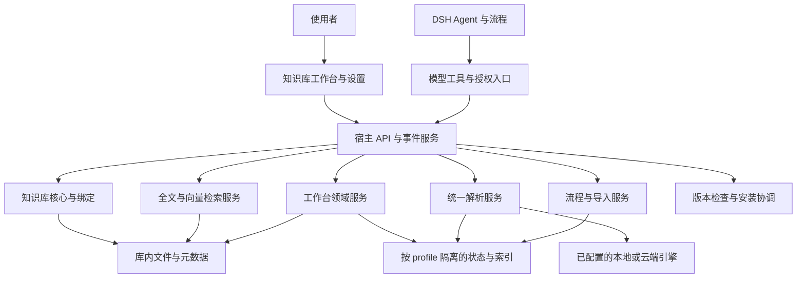

# 插件设计与演进记录

<!-- project-record-version: 2.1.4 -->

**对应实现：2.1.4 · 更新日期：2026-10-26 · 维护方式：随每次发布更新，与源码一起审阅。**

这是个人知识库插件的长期记录，面向使用者、维护者和后续开发者。它说明产品为什么这样构建、目前能做什么、功能如何连接、数据放在哪里，以及下一步往哪里走。这里的“已实现”以本仓库源码为依据；路线图属于后续方向，不代表已经提供。实际安装版本与构建号以客户端运行状态和对应发布清单为准。

使用步骤见 [工作台说明](WORKBENCH.md)，每次发版的变化见 [更新记录](RELEASE.md)，版本比较规则见 [版本命名](VERSIONING.md)。本文负责解释整个产品，避免把发布说明当成架构文档。

## 2.1.4 后台更新与完成状态（2026-10-26）

同一大版本内可自动安装的正式版不再进入更新前选择弹窗；跨大版本、预览通道及安装接口不可用的情况继续保留手动入口。宿主构建和客户端版本均匹配后更新共享版本状态，失效旧请求并强制重新检查，避免迟到结果还原已安装版本的提示。正式版补丁不弹更新内容，小版本或大版本升级继续合并未读内容。

26 项定向检查通过，覆盖安装恢复、静默提示、完成状态、迟到检查和更新说明已读；未在真实 DSH 宿主安装验证。版本、安装包、发布清单与官网入口同步为 2.1.4。

## 2.1.3 响应与检索性能（2026-10-26）

工作台继续沿用 SSE，资料变更以 200ms 合并刷新；可见页面 60 秒兜底，隐藏时暂停，恢复可见或焦点时刷新。检索关闭时文件 watcher 仍可通知工作台；服务端先失效快照，再广播变更，防止旧的并发扫描写回缓存。关系索引补齐完成/失败事件，进度只在更新期间轮询。

主线程复用分块和输入哈希，worker 按库、权限、配置及目录版本保留资料索引，资料变化时只传增删改；复用词频、长度、文档频率和倒排项，保留短词、引号短语及跨分块匹配。主线程目录与 worker 词法目录分别设置 128 MiB 的估算预算，向量 Buffer LRU 上限为 64 MiB；对象实际堆占用可能更高，超限回退完整计算，不减少覆盖。

分片每次查询核对文件身份、大小和 mtime/ctime，继续逐向量 checksum、边界与有限数检查。构建按批按分片打开与同步，全部同步和取消/配置复核成功后才原子提交 manifest，保留旧代次和失败重试。trace 增加阶段耗时、缓存和字节计数，不新增查询原文、资料正文、路径或密钥。

20,000 份合成单片段资料的 worker 暖查询 p50 约 109ms → 17ms，p95 约 129ms → 40ms；冷查询略增，不能等同真实库或整个界面速度。定向回归与浏览器刷新简查通过，未在正式宿主或真实云 API 验证，未读取个人知识库。扫描并发保留为测量驱动的后续条件项。源码、客户端版本与公告、说明、官网入口、安装包和发布摘要同步为 2.1.3。完整条件见 [性能优化记录](PERFORMANCE.md)。

## 2.1.2 关系画布全屏（2026-10-26）

关系网络新增“全屏画布 / 退出全屏”，图谱和关联清单一起铺满应用窗口。画布按实际区域宽高比调整，减少宽屏留白；缩放、拖拽、适配与节点详情继续可用。Esc 优先退出全屏，切换页签或进入链接检查时自动收起；全屏状态不持久化。

装载源为 `workbench-ui.js`，通过同步脚本生成 `index.js` 嵌入区。`workbench-relations.js`、`workbench-features.js` 与 `workbench-theme.css` 是历史拆分副本，不作为当前界面构建入口。交付目录中的同版本新构建在本次正式发布中统一为 2.1.2；源码、随包文档、官网、下载包和摘要清单同时更新。来源构建通过合成宿主浏览器检查，本次重新打包后执行定向回归及发布一致性检查；未在真实桌面宿主安装，未验证真实模型或云 API。全屏定位仍受宿主祖先元素样式影响。公开提交不包含本机运行日志、截图或知识库资料。

## 2.1.1 发布入口维护

当前入口统一推荐正式版 2.1.1；撤下被正式版取代的预览包及下载副本，预览清单使用 active:false 表示暂无预览版。更新器兼容空预览通道，并过滤落后于正式版的旧镜像预览，保留未来新预览的发布能力。官网版本、安装指南与下载链接同步到 2.1.1。历史发布说明保留为演进记录。

## 2.1.1 收件箱与滚动维护（2026-10-23）

收件箱复用已有 DeleteFile 与 trash.move 两阶段确认流程，原件移入回收站后刷新列表，保留恢复能力。工作台高度按窗口剩余空间计算，避免宿主挂载阶段父容器零高度导致空白。移除祖先滚动位置归零，保留自然滚动传递；详情底部按宿主输入框遮挡高度预留空间，并跟踪输入框的挂载和尺寸变化。验证使用虚构库覆盖删除知识笔记后删除原件、零高度父容器、桌面与窄屏、边界短预览。未将真实知识库内容、设备截图或运行日志收入发布物。

## 2.1.0 检索更新（2026-10-22）

用户搜索和引用问答接入统一全文/向量检索，采用结构切片、双向局部补充、RRF、可选通用重排序及原文上下文展开。设置页内置硅基流动 BGE-M3，提供通用 Embedding 与 Rerank API；保存启用后自动增量建库。只估算空间，不设置容量预算。向量以 Float32 二进制分片保存；章节和片段保留原文位置，不另存切片正文。实现入口为 `retrieval.js`、`retrieval-chunks.js`、`retrieval-api.js`、`retrieval-worker.js`。使用步骤和边界见 [检索说明](RETRIEVAL.md)。下文保留既有核心索引和兼容接口的说明；面向用户的新检索以本节和检索说明为准。

## 2.1.0 可靠性与升级维护

检索 worker 常驻复用、内容指纹分词缓存和同时在途查询合并均不缓存最终答案；保留候选、证据范围、权限和版本核对。新版问答协议不默认重复回传答案，轮次结束检查来源引用并最多请求一次定向修正。库内 `.kbmeta` 记录机制版本与托管文件指纹，自定义文件保留并提供差异。动态记忆重注入修复属于配套 memory-evolve 补丁，不修改宿主核心。

## 2.1.0 正式发布记录（2026-10-22）

正式版首次通过 [PR #25](https://github.com/KingsleyAsher/Personal-Knowledge-Base/pull/25) 合并至 `main` 并发布 GitHub Release：[`v2.1.0`](https://github.com/KingsleyAsher/Personal-Knowledge-Base/releases/tag/v2.1.0)。首次发布提交为 `bf41c52c088495596c619af30b38a4a4bc43a3e1`；随后 [PR #26](https://github.com/KingsleyAsher/Personal-Knowledge-Base/pull/26) 完成发布记录、随包文档、安装包和校验清单的全量同步，合并提交为 `5abc0bbfd37162e91343906aa761a37ea590639f`。构建号仍为 `37b7ff660806754d`，因为该次同步没有改变可执行构建文件。当前安装包字节数、SHA-256 和逐文件清单以 [`release-manifest.json`](release-manifest.json) 为准。用户确认 2.1-beta4 预览版可用；没有在维护者本机安装正式包，也没有调用真实云端模型 API。正式版发布检查和展示页部署通过；Gitee 镜像同步成功，GitCode 镜像同步工作流失败，镜像结果以工作流记录为准。

## 目录

- [1. 产品定位与构建方向](#1-产品定位与构建方向)
- [2. 基础能力与使用闭环](#2-基础能力与使用闭环)
- [3. 架构、框架与宿主关系](#3-架构框架与宿主关系)
- [4. 数据组织与状态归属](#4-数据组织与状态归属)
- [5. 核心实现方案](#5-核心实现方案)
- [6. 权限与可靠性](#6-权限与可靠性)
- [7. 界面与交互约定](#7-界面与交互约定)
- [8. 构建、发布与文档维护](#8-构建发布与文档维护)
- [9. 源码导航](#9-源码导航)
- [10. 演进路线与设计取舍](#10-演进路线与设计取舍)
- [11. 后续方向与未来展望](#11-后续方向与未来展望)
- [12. 当前边界与验证口径](#12-当前边界与验证口径)

## 1. 产品定位与构建方向

产品运行在 DeepSeek Harness（DSH）内，将本地资料、阅读积累、关系浏览和 Agent 工作连接起来。使用者可以先绑定已有文件夹，再逐步整理资料；文件和笔记仍由使用者持有。

构建遵循以下方向：

1. **本地资料可以独立存在。** 常规内容采用文件与 Markdown，运行状态采用可检查的 JSON；插件承担管理、浏览和协作能力。
2. **使用者能理解每次操作。** 检索、解析、写入、修复、删除、恢复和安装更新需要有明确对象、状态和结果。
3. **权限贯穿执行过程。** 展示权限、问答权限、解析来源权限及管理配置权限各自判断；界面隐藏按钮之后，后端仍然校验。
4. **先复用，再增量处理。** 文件索引、关系索引和解析结果避免为切换视图反复读取与执行。
5. **扩展依托宿主。** 复用 DSH 的会话、Agent、React、工具、预设和插件管理服务，能力缺失时给出明确反馈。

## 2. 基础能力与使用闭环

| 板块 | 用户能做什么 | 对后续工作的作用 |
|---|---|---|
| 总览 | 继续阅读、查看近期资料与待办、进入分区 | 从正在做的事情开始 |
| 资料目录 | 按目录、名称、路径或正文查找，切换卡片和清单，打开详情 | 找到可浏览的资料并继续操作 |
| 关系网络 | 查看全库分区、选择中心资料、下钻、筛选、高亮节点与连接 | 理解资料之间的来源、引用和手动关系 |
| 链接检查与修复 | 查看问题、位置、上下文与候选目标，预览后修复 | 使变更有依据，保留无法自动确定的问题 |
| 收件箱 | 收集文本、网页和文件，整理导入待处理项 | 将零散输入转为可追踪资料 |
| 阅读与摘录 | 保存阅读状态与位置、摘录和批注，回到来源，生成笔记或导出 | 将阅读过程沉淀为自己的知识 |
| 回顾 | 查看回顾安排、最近普通内容及折叠的系统改动 | 重新使用积累并减少系统噪声 |
| 流程与任务 | 定义、运行、查看流程和成品，与会话协作 | 让重复工作保留过程与结果 |
| OCR／ASR | 使用已配置服务识别或转写，查看提交与执行记录 | 将难以检索的输入变为可用文本 |
| 回收站 | 恢复普通文件、永久删除、查看剩余保留时间 | 为日常删除提供恢复窗口 |
| 设置与备份 | 管理隐私、服务、采集连接、备份与运行诊断 | 让数据范围和执行方式可控 |

常用闭环为“收集 → 识别／整理 → 检索与阅读 → 摘录或笔记 → 关联 → 回顾与流程”。各步可独立使用，解析结果也可以只返回发起会话，不必立即入库。

## 3. 架构、框架与宿主关系

### 3.1 分层结构

### 3.2 技术选择

| 层次 | 当前实现 | 选择原因 |
|---|---|---|
| 宿主插件 | JavaScript ES Modules、Node.js 标准库、DSH `ctx` 服务 | 直接使用宿主能力，减少独立运行时 |
| 桌面客户端 | 宿主 React／ReactDOM、`createElement`、CSS、slot 注册 | 与会话和设置共存，避免加载第二份 React |
| 页面组织 | 工作台页面状态、浏览历史、共用主题和可调整分栏 | 保持导航、详情和操作一致 |
| 文件与持久化 | 原始资料文件、Markdown、JSON、摘要和原子写入 | 支持本地可检查的数据与版本校验 |
| 关系计算 | 引用提取、目标解析、持久化单文件关系索引和邻接查询 | 让重复浏览复用已有结果 |
| PDF | 随包提供的 PDF.js 资源及阅读界面 | 支持页码、文字和区域摘录 |
| 浏览器采集 | 独立浏览器扩展、收集网页、PWA 相关资源 | 把外部内容送到受管收集入口 |
| 发布 | npm 安装包、Python 构建／核验脚本、GitHub Actions 和 Pages | 让源码、包、清单、下载页可以互相核对 |

宿主入口通过服务注入注册工具、HTTP 路由、事件和界面；注册和订阅通过 `ctx.effect` 管理生命周期。客户端工作台源文件会在打包前嵌入主客户端工厂。修改工作台时应修改原始模块，再运行同步脚本，避免直接改生成区而在下一次构建丢失。

## 4. 数据组织与状态归属

| 数据 | 存放及归属 | 维护原则 |
|---|---|---|
| 正文、附件、笔记 | 使用者选定的知识库目录 | 保留可直接打开的原文件 |
| 库身份与库内元数据 | 库内 `.kbmeta/` 等受保护路径 | 核对知识库身份后访问或写入 |
| 全文与向量索引 | 知识库根目录的 `索引层/` | 依照库身份、文档版本和活动模型维护，可暂停、续建或重建 |
| 插件配置与状态 | 当前 DSH profile 对应的 `kb-state`，支持明确配置的状态目录 | 各 profile 隔离；绑定以已保存配置为准 |
| 工作台偏好与用户数据 | 状态目录下 `workbench/`，按库绑定保存 | 阅读、摘录、回顾和手动链接按库隔离 |
| 关系缓存 | 状态目录下 `workbench/relations/` | 可重建；保留引用、锚点、版本信息与有限上下文，不复制完整正文作为关系库 |
| 解析请求、任务与结果 | 状态目录下 `parse/`，按库及任务隔离 | 结果读取、复用和入库均需匹配来源及权限 |
| 回收站文件 | 库内 `.kbmeta/trash/` | 保存原路径、摘要、时间、操作状态及专属元数据 |
| 流程配置与结果 | 状态目录的流程数据、受管成品文件 | 标记发起任务、所属库和输出对象 |
| 界面本地偏好 | 浏览器本地存储 | 分栏宽度按设备、库与页面保存；更新说明保存已读状态 |

系统文件按职责识别：任意层级的 `INDEX.md`、`AGENTS.md`，根目录的 `README.md`、`知识库清单.md`，以及内部受保护路径。匹配规则由后端统一维护。手册、模板、请求通道中的普通资料并不会因所在目录而全部失去删除权限。具体规则见 [`workbench-files.js`](src/host/workbench-files.js)。

## 5. 核心实现方案

### 5.1 建库、绑定、导入与索引

选目录先记录候选；明确执行自动建库／识别后判断空目录、已有库或普通资料夹。导入先冻结来源清单和摘要，再执行接入或复制；进度、跳过项、失败项和待解析内容可追踪。全文与向量检索共用文档身份和原文位置，索引维护具有快照、不完整扫描和异常下降保护，不能把扫描失败当成所有资料都已删除。

### 5.2 关系网络与修复

关系管线分为“文件变化检查 → 单文件引用提取 → 标题／路径目标解析 → 图查询”。引用来自实际资料中的来源字段、文内链接以及使用者保存的手动关联；AI 提议须预览确认后才能保存。

关系索引按知识库身份、规范路径与格式版本隔离。未变化的文件复用提取结果；变化候选读取后核对内容版本；完整重扫强制核验。并发请求共用更新任务，界面可见时轻量检查外部编辑。阅读进度与回顾状态不应触发关系正文重建。索引同步状态和时间提供给界面，更新时尽量保留缩放、选中项和画布位置。

标题或路径变化会影响引用解析，不能只替换节点显示名称。删除与恢复同时影响节点、边和问题状态。修复操作执行前重新核对文件版本，避免把旧缓存中的建议写入已变化原文。重名或证据不足的目标交由使用者选择。

### 5.3 阅读、摘录、检索与问答

阅读记录关联资料路径，保存状态、滚动位置或 PDF 页码；摘录保存原文、批注及来源位置。定位失败时保留来源入口并反馈限制，扫描版区域摘录不等于已经完成 OCR。多条摘录可以生成带来源的笔记。

问答入口复用全文与向量协同检索和受控原文读取，支持精确匹配、BM25、dense 向量召回、一轮双向局部补充、RRF 融合、可选通用重排序及来源上下文恢复。`@` 知识引用以宿主原生标签进入会话。回答引用按文档版本和当前权限校验；漏引或跳过校验时可发起一次定向修正，但不把相似度或引用检查宣称为答案正确率证明。隐私展示和允许私密问答是不同设置；能在界面查看不等于任意 Agent 可以读取。

### 5.4 统一解析通道

受管 Agent、导入和流程的 OCR／ASR 通过统一服务登记请求，再执行已配置引擎。Agent 可提交自己获准访问的工作区文件或附件；服务签发并核验文件引用，校验真实路径、会话身份与当前权限。个人知识库访问仍使用独立授权规则。

提交记录和执行任务分开：配置、格式或权限拒绝应有可解释的请求结果；进入执行后记录排队、运行、成功、失败、取消或部分结果。任务按权限及类型筛选后分页，通过事件和可见页面刷新补充状态。复用结果会标明复用，不能伪装成重新执行。

服务支持已配置的本地方式、CLI、兼容 API 及部分原生接口，配置和凭据管理属于用户管理面。默认路由失败后明确报错，不能自行改用外部脚本或上传云端。用户明确指定通道外工具时允许该次执行；本插件保留宿主日常终端和网络权限，因此无法技术性阻断任意其他脚本、HTTP 或插件的绕过。详细配置见 [解析与维护说明](PARSING-PREVIEW.md)。

### 5.5 删除、恢复与备份

普通可见且可写文件可直接移入回收站，入口在文件条目右侧及详情等操作区。确认时说明原路径、保留期限与引用影响。现阶段只处理单文件；正文中的引用保留，目标状态交由关系与链接检查展示。

回收站以删除时间起算 `30 × 24` 小时；宿主启动及运行期间的定期清理处理到期条目。恢复遇到同名原路径停止，避免覆盖。恢复同时恢复该文件专属的阅读、摘录、回顾和手动关联；永久删除清理对应回收站对象及专属状态。移动、恢复、清理通过操作状态和锁识别中断并重试。

完整备份默认关闭。备份包含清单与文件校验，恢复时核对身份和变更；回收站内容不纳入普通导出和完整备份。回收站永久删除不追溯销毁此前单独创建的备份，使用者需要分别管理备份副本。

### 5.6 更新与更新说明

正式版采用 `x.x.x`，预览版采用 `x.x-betaN`。正式／预览清单与包身份、大小、摘要、构建号相互校验。更新源并发检查，镜像延迟时采用可用源中的最新版本；同版本摘要冲突阻止安装，下载失败按配置切换。宿主插件管理器负责实际安装，只有运行构建与安装结果匹配后才能报告加载成功。

同一大版本内可自动安装的正式版在后台更新，不弹“有可用更新”；跨大版本和预览通道按当前安装渠道提示手动选择。宿主构建与客户端版本均核对成功后刷新共享版本状态、失效旧检查请求并重新检查，防止已安装版本继续显示为可用更新。“已经安装新版本”的更新说明单独维护。正式版跨大／小版本展示说明，单独补丁升级不弹；预览更新每次展示。跨多个版本时，内部仍保留区间信息用于准确汇总，界面只显示一份去重后的更新内容，不再给每个历史版本列标题。关闭、Esc 或遮罩关闭都记录已读状态。

## 6. 权限与可靠性

- 文件操作使用规范化相对路径、真实路径检查和目录边界验证，拒绝路径逃逸及不允许的目录链接。
- 写入核对知识库身份和预期版本；多个进程通过锁协调，状态通过临时文件再替换保存，保留异常原文件。
- 解析来源令牌绑定活跃 Agent、会话和授权范围；管理配置不向模型侧开放。知识库授权及宿主隔离状态按对应入口重新核对。
- 展示、搜索、回收站、问答和任务列表按各自权限过滤，过滤在分页及截取数量之前进行。
- 云端处理服从明确配置，失败不会自动降低隐私策略。凭据采用受管引用，不写入公开文档或普通任务正文。
- 知识内容、可重建索引、用户状态和构建产物分别维护；升级或重建索引不应主动改写使用者的资料正文。

这些是当前实现原则，不能据此宣称插件替宿主提供了完整操作系统沙箱；文件与网络隔离仍依赖宿主所提供的能力及部署方式。

## 7. 界面与交互约定

工作台各页共用顶部搜索、快速收集、回收站、设置、版本入口和返回导航。文字按可用空间换行；详情与列表使用可拖动分隔条，并支持键盘调整和重置，窄窗口切换单栏。

关系画布支持拖拽、缩放、适应视图与层级探索。选中节点或连线会高亮相关卡片和连接；用户可以查看证据或打开资料。文件删除使用明确文字按钮，并与打开文件的点击区域分开。加载、空内容、错误、保存成功和操作进行中分别反馈。

本记录的入口固定在 README 前部、知识库工作台设置页，以及 DSH“个人知识库”设置中。在线链接指向主分支的最新记录；安装包同时附带该版本的文档快照，离线也可以查看对应版本内容。

## 8. 构建、发布与文档维护

构建顺序为：修改原始模块 → 同步客户端嵌入区 → 同步构建文件清单 → 生成 npm 包 → 逐文件及构建号校验 → 更新发布清单与网站下载 → 合并主分支 → 创建正式标签 → 发布资产与网站。

`buildId` 根据入口声明的装载文件清单和逐文件 SHA-256 计算；清单会随模块扩展，不应把早期的固定文件数量当作永久规则。安装包另外记录包大小、SHA-256、SRI 和文件清单。发布包摘要由实际字节计算；文档内不手写容易失效的构建号，以对应 `release-manifest.json` 为准。

主要工具：[`package-workbench.py`](tools/package-workbench.py)、[`sync-workbench-client.py`](tools/sync-workbench-client.py)、[`sync-workbench-build.py`](tools/sync-workbench-build.py)、[`verify-release.py`](tools/verify-release.py)、[`stage-stable-candidate.py`](tools/stage-stable-candidate.py)。网站位于 [`website/`](website/)，经 GitHub Pages 部署；镜像仓库的同步权限、模式和延迟以平台实际结果核验。

### 公开资料隐私边界

公开仓库、网站、发布说明、样例配置和安装包不得包含维护者的设备路径、账户目录、个人资料内容、真实文件名、设备 IP、局域网地址或个人服务端口。需要说明配置方式时，使用 `WORKSPACE_ROOT`、`DSH_HOST`、`PORT` 等明确占位符，并要求使用者从自己的宿主设置中填写。通用产品协议、文档保留地址和动态测试端口应与真实环境配置分开说明。

每次发布由发布核验脚本扫描随包文档中的绝对路径、IP 地址和本机地址加固定端口；维护者还需检查知识库内容、账号名和服务地址等无法仅靠正则规则可靠识别的内容。修正公开资料时同时检查主分支、历史标签、网站副本和发布资产。

**每次发版必须同步维护本记录：**

1. 修改顶部“对应实现”、日期和 `project-record-version` 标记。
2. 按实际变化更新能力、数据、架构或限制；无架构变化也要登记当次变更。
3. 在演进记录新增版本及关键决策，未来工作不能提前写为已实现。
4. 同步 README、设置入口、版本规则与发布说明；本文随安装包分发。
5. 发布核验脚本检查本文版本标记与包版本匹配，并执行文档隐私扫描；未通过时阻止发布。

主分支文档记录最新源码状态；历史文档可通过对应 Git 标签追溯。修改已发布版本的实现时发布新补丁包，不替换已有标签下的安装包。

## 9. 源码导航

| 模块 | 职责 |
|---|---|
| [`src/host/index.js`](src/host/index.js)、[`cordis.patch.yml`](cordis.patch.yml) | 服务装配、工具／路由／事件注册、宿主配置 |
| [`kbcore.js`](src/host/kbcore.js)、[`fsindex.js`](src/host/fsindex.js) | 绑定、库身份、条目、文件扫描与检索基础 |
| [`index-maintenance.js`](src/host/index-maintenance.js) | 索引维护、快照与异常保护 |
| [`workbench.js`](src/host/workbench.js)、[`workbench-state.js`](src/host/workbench-state.js) | 工作台业务、状态、路径和锁 |
| [`workbench-files.js`](src/host/workbench-files.js)、[`workbench-trash.js`](src/host/workbench-trash.js) | 文件职责、操作能力、回收站与期限清理 |
| [`workbench-relation-index.js`](src/host/workbench-relation-index.js)、[`workbench-links.js`](src/host/workbench-links.js) | 增量关系提取、目标解析、修复与证据 |
| [`workbench-question.js`](src/host/workbench-question.js)、[`gateway.js`](src/host/gateway.js) | 受控问答、引用校验与知识授权 |
| [`parsing.js`](src/host/parsing.js)、[`parse-source-authority.js`](src/host/parse-source-authority.js) | 请求、执行、结果、文件来源授权 |
| [`parse-native.js`](src/host/parse-native.js)、[`parse-discovery.js`](src/host/parse-discovery.js)、[`parse-credentials.js`](src/host/parse-credentials.js) | 原生服务适配、本地发现、凭据管理 |
| [`importer.js`](src/host/importer.js)、[`import-service.js`](src/host/import-service.js) | 资料识别、导入清单与执行 |
| [`flows.js`](src/host/flows.js)、[`flow-workspace.js`](src/host/flow-workspace.js)、[`workbench-deliverables.js`](src/host/workbench-deliverables.js) | 流程、会话关联和成品管理 |
| [`workbench-backup.js`](src/host/workbench-backup.js)、[`capture-surface.js`](src/host/capture-surface.js) | 备份恢复、外部收集页面与连接 |
| [`updates.js`](src/host/updates.js)、[`versioning.js`](src/host/versioning.js) | 更新源、下载与包验证、版本比较 |
| [`src/client/index.js`](src/client/index.js) | 客户端装配、设置、更新提示与更新说明 |
| [`workbench-ui.js`](src/client/workbench-ui.js)、[`workbench-theme.css`](src/client/workbench-theme.css) | 原始工作台界面和共用样式 |
| [`workbench-features.js`](src/client/workbench-features.js)、[`workbench-relations.js`](src/client/workbench-relations.js) | 阅读／分栏等交互辅助、关系画布 |
| [`browser-extension/`](browser-extension/)、[`presets/`](presets/)、[`skills/`](skills/) | 浏览器采集、预设与随包技能 |

## 10. 演进路线与设计取舍

| 阶段 | 已形成的能力与决策 |
|---|---|
| 早期版本 | 建立本地绑定、标准目录、条目检索和知识库预设，形成受控知识入口 |
| 1.1.x | 增加解析服务、导入、索引维护与配置界面；完善授权、凭据、更新下载和多源检查 |
| 2.0-beta1 至 beta6 | 将资料管理扩展为工作台，加入阅读摘录、关系、收集、备份与使用引导，持续调整地图和解析界面 |
| 2.0-beta7 | 统一知识库各页导航和样式，恢复关系拖拽缩放、选择与分区探索 |
| 2.0-beta8 | 恢复顶部更新、可调整分栏、系统资料分类、阅读引导及 30 天回收站 |
| 2.0-beta9 | 引入增量关系索引、直接删除、统一解析任务记录和按安装渠道提示更新 |
| 2.0.0 | 工作台转为正式版，统一版本格式、迁移比较及发布前修复 |
| 2.0.1 | 更新说明改为合并去重内容清单；建立本记录及 README／设置入口，把文档版本纳入发布检查 |
| 2.0.2 | 清除公开材料中的设备路径、个人目录与本机服务地址；增加发布文档隐私扫描及后续维护规则 |
| 2.1-beta1 | 加入多语言全文与 dense 向量并行召回、长文结构切片和 BGE-M3 API 配置 |
| 2.1-beta2 | 加入检索计算缓存、请求隔离、证据缺口补查与机制升级协调；保留召回候选和原文范围 |
| 2.1-beta3 | 修正问答引用校验协议，保留可验证来源并兼容旧调用 |
| 2.1-beta4 | 增加轮次结束引用检查和一次定向修正；记忆动态状态隔离作为单独补丁提供 |
| 2.1.0 | 正式发布协同检索、自动增量建库、用户文件保护与运行机制升级维护 |
| 2.1.1 | 收件箱回收站、窗口高度与滚动修复、图标和发布入口统一 |
| 2.1.2 | 关系画布全屏、按区域宽高比布局及安全退出 |
| 2.1.3 | 事件合并刷新、检索目录增量复用、分片缓存、批量同步和阶段耗时指标 |
| 2.1.4 | 正式版后台更新、完成状态同步与旧检查结果隔离 |

主要取舍是保留文件可移植性、先让本地确定性流程可靠、再增加 AI 辅助。关系缓存服务于现有文件关系，AI 建议与确定存在的引用分别呈现；解析任务登记与最终入库分开；更新检查与安装分开。这样每个自动步骤都有可以说明的对象与结果。

## 11. 后续方向与未来展望

以下为待评估方向，没有预定发版承诺：

| 优先方向 | 计划解决的问题 | 开始扩大范围前的判据 |
|---|---|---|
| 稳定与可观测性 | 用户难区分读取失败、同步延迟、任务未提交和运行失败 | 状态可解释，错误有入口，诊断不暴露敏感内容 |
| 大资料库性能 | 外部编辑、批量改名、大关系图与长列表的成本 | 记录实际读取次数、耗时和内存，证明增量更新正确 |
| 阅读与来源定位 | 不同格式的定位精度和原文变化后的锚点恢复 | 能核对来源，定位失败时有明确退路 |
| 关系质量 | 重名、模糊引用、复杂链接及 AI 建议难解释 | 每条关系有来源或确认记录，修复可预览 |
| 解析扩展 | 多模型、多种文件与调用方的统一记录 | 同一权限、请求、任务与结果契约通过后再扩适配器 |
| 检索质量与规模 | 多语言效果、超大索引延迟和候选质量因资料而异 | 用可公开样本评估召回、证据完整性和延迟；不能减少原文证据范围来换取表面提速 |
| 数据迁移与协作 | 多设备、导出及多人工作可能引入冲突 | 先确定身份、版本和冲突规则，再考虑同步能力 |
| 文档与兼容治理 | 功能增加后说明、宿主契约和安装包容易漂移 | 每版更新本记录，保持能力和限制可追溯 |

长期目标是让“资料能找到、理解可留下、来源可核对、工作能复用”持续成立。未来增加语义检索、更多格式或协作能力时，仍要保留本地文件、明确授权、可解释关系和可恢复操作这些基础。

## 12. 当前边界与验证口径

本插件依赖 DSH 的工具、会话、UI 与安装能力；宿主版本与部署方式会影响可用性。本地模型、Python 环境、FFmpeg 或第三方云服务按各适配器要求单独准备。扫描发现模型不等于模型已成功启动，解析返回结果也不等于正确识别所有文字。

静态检查、合成资料测试、真实桌面验收和真实模型执行分别记录。2.1.0 发布前的 25 项定向自动检查通过，GitHub 正式发布工作流与 Pages 部署通过；用户确认 2.1-beta4 预览版可用。2.1.0 未在维护者本机安装验证，也未调用真实云端 Embedding/Rerank API。发布清单只记录已实际完成的验证，不以模拟服务结果替代真实模型、完整长文识别、多设备同步或所有宿主版本的验证。

**维护记录：2026-10-22，建立首份完整记录；同日补记 2.1.0 正式发布与检索实现，后续提交按第 8 节持续更新。**

### 2026-10-22 检索设置与存储修复

- 合并配置和索引操作按钮；索引通知仅刷新状态，暂停不重置设置页面，任务操作保留未保存输入。
- 索引迁移到知识库 `索引层`，复制校验后清理旧数据；排除正文枚举、备份和构建监听，空间统计使用所在磁盘。
- API 凭据仍由 Windows 加密，保存在版本无关的 profile 状态目录；按端点保留引用并显示已保存状态，更新无需重复填写。
- 仅做定向自动检查及一次虚构数据页面交互检查，不调用真实云 API，不做规模压测。

2026-10-22 补充：索引直接保存到知识库的 `索引层`，不再套 `向量检索`；旧子目录首次加载自动迁移。知识库设置新增默认开启的“回答后显示知识库检索过程”，工具依据实际执行记录生成回答末尾说明，涵盖全文、向量模型、交叉补充、融合、重排序及上下文读取；未检索或关闭时不追加。

2026-10-22 引用展示修复：`@基于知识库回答` 发送时改用短格式知识库引用（`dsh-kb:` + 本次问题身份），检索与引用校验说明放入工具定义。通过宿主 `uiConversation.userText` 和 `conversation.user.text.node` 显示原生蓝色引用标签；匹配完整旧版提示词时也显示为标签，原始聊天记录不被改写。标签保留含隐私/不含隐私区分，服务端会话、版本与权限校验不变。

### 2026-10-22 / 2.1-beta2

以 `03bcde504978f416` 为对照，归档未交付优化草稿。移除有损截断、自动省略证据及共享 worker 硬超时方案，交付计算缓存与请求隔离；保留原召回和正文范围。问答协议 2 与旧协议兼容，支持结构化证据审查。升级协调按格式/算法判断复用，按实际应用指纹保护托管文件；对用户 AGENTS、人工导航和自定义预设保持保守。独立状态显示检查、失败、索引构建/暂停及待新会话生效。该阶段随后经 beta3、beta4 用户确认，纳入 2.1.0 正式发布。

### 2026-10-22 / 2.1.0 正式发布

2.1.0 通过 PR #25 首次发布，并于 PR #26 完成正式发布记录、随包文档、安装包、网站下载副本和摘要清单的同步。当前发布包身份见 `release-manifest.json`，构建号仍为 `37b7ff660806754d`；PR #26 只更改文档和发布元数据，没有改动可执行构建文件。用户确认预览版可用；定向自动检查 25 项通过，首次正式发布及 Pages 工作流通过。Gitee 镜像同步成功，GitCode 镜像工作流失败。此后若有发布记录更正，应同步源码记录、随包副本、清单及对应下载附件，并以发布清单中的摘要为准。

客户端内下载入口：知识库 → 收件箱 → 浏览器扩展使用指南 → 首次使用：安装与连接，点击“下载浏览器扩展”，自动匹配 Gitee、GitCode、GitHub 并校验下载文件，源失败时自动切换；全部失败时显示原因与备用链接。
