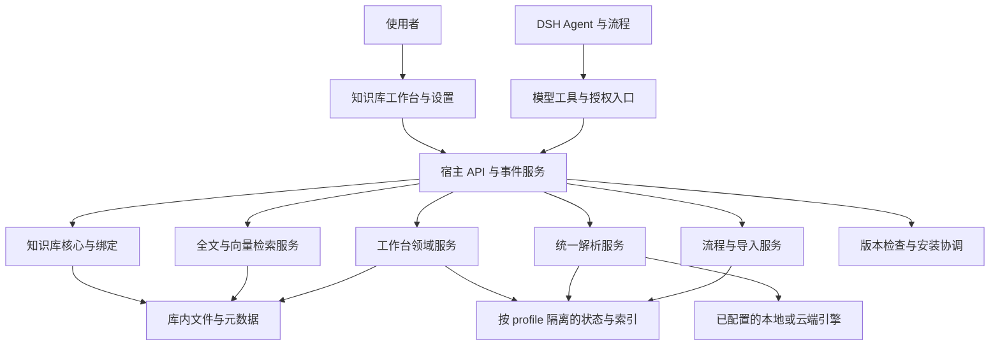

# 个人知识库 · 统一设计与演进记录

[简体中文](PROJECT-RECORD.md) · [English](PROJECT-RECORD.en.md)

## 2026-11-10 · 启动去重与索引维护稳定性（2.5.13 / 1.1.4 未发布候选）

修复客户端打开现有库时重复创建示例库、无恢复任务也提交恢复写入、连接就绪时强制重读全部文档，以及启动目录树重复加载。相同配置在锁内校验后直接返回，保留配置文件和修订号，不再无故重启索引监听；同一文档的并发加载合并。重连先检查文件修订，保留未保存编辑；PDF/Office 等服务资源句柄仍重新获取。恢复副本仍执行完整状态恢复，真实策略修改仍触发维护。

隔离 Electron 对照中，默认工作区启动目录请求由 18 次降至 9 次；未变化 Markdown 重连重读为 0，外部修改仍触发刷新，无页面脚本错误。验证并发配置/索引维护、升级交接与失败恢复、备份恢复、错版本互通及启动路径。正常更新不强制全库重建：服务启动保留增量核对，未变化内容复用既有索引；损坏或旧格式索引仍按既有修复规则处理。没有以调用次数减少宣称整库耗时同比下降；生产知识库未用于测试。本次重新生成未发布候选构建，不代表已公开发布或安装到用户环境。

## 2026-11-10 · 错版本互通补测与修复

复现并修复两项错版本问题：新增可选接口改变整体契约摘要，导致旧端无法接入新服务；新客户端把整理结果核对当成必需能力，导致无法接入仍在运行的旧插件服务。现在保持既有接口的基础协议摘要，新增能力单独协商；对缺少核对能力的旧服务显示更新提示，文件管理继续可用。已有接口变更、未知协议、存储/引擎世代不兼容及缺少必需能力仍明确拒绝，不建立第二个写入者。

使用原始历史 TGZ 验证 2.5.5、2.5.10、2.5.12 和上一份 2.5.13 候选包，覆盖新旧服务、插件/客户端先连接、跨端读写、过期修订冲突及同时启动。测试纳入客户端和发布 CI。此修复更新未发布的 2.5.13 / 1.1.4 候选构建，既有正式版本未覆盖，生产资料未改动。

## 插件 2.5.13 / 客户端 1.1.4 · 发布审查修复（未发布）

修复来源映射损坏时的隐私边界和并发入库覆盖；原件备份保留分类目录与索引策略，恢复后验证资料库健康状态。客户端恢复副本建立独立身份和授权，可再次打开并由插件适配器接入同一服务。

首次建库可继续完成中断的初始化，并安全回收死亡进程的启动锁；存活或无法核对的锁继续拒绝接管。离线迁移保留中断暂存，核对原状态后重建；未完成的迁移日志可继续提交，其他已登记资料库不会丢失。整理任务结果未知时新增明确核对入口，拒绝迟到回执，避免盲目重复发送。本机引导凭据到期前自动续期，撤销的授权不会复活。

明确示例建库与真实文件夹接入入口。修复镜像发布说明解析和独立界面模块语法；补齐首次建库、索引迁移、服务生命周期及 Windows 热更新的 CI 检查。升级 PDF.js 与打包依赖，并修复数学渲染依赖审计问题。新增故障回归覆盖来源映射、并发入库、备份恢复、建库中断、启动锁、任务核对、凭据续期和离线迁移。

验证使用隔离合成资料，覆盖插件独立建库、客户端独立打开和两端共库单写入者；未修改用户真实资料。这是待发布源码及本地候选包，不表示已发布、安装或完成真实模型云端验收。最终验收结果见本次发布审查报告。

本地验收：Node 全套 327 项中 325 通过、2 项环境条件跳过；随后补跑打包 Electron 的 ASAR 用例通过，恢复策略最终针对性复测 28 项通过。Python 23 项通过，两组依赖审计均为 0。客户端实际打开并渲染 PDF；隔离安装、启动和卸载通过，额外用户文件保留。安装器尚未签名；未执行真实 DSH profile 安装或云端模型调用。

<!-- project-record-version: 2.5.13 -->

**对应源码：插件 2.5.13 / Windows 客户端源码 1.1.4 · 更新日期：2026-11-10**

## 插件 2.5.12 · 首次共库与整理流程刷新

Windows 首次从空目录建立共享库时默认启用原件索引。插件与客户端可以独立使用，也可以连接同一个库。插件首次绑定共享库后，需完全退出 DSH 并重新打开。已有嵌入式库仍通过显式迁移接入。

更新完成或服务重连后，流程页面自动刷新。启动收件箱整理前会读取当前流程修订号。同库配置发生变化时，只重试一次尚未执行的准备步骤。切换知识库时停止原库请求并提示。

Windows 测试覆盖两端各自建库、独立使用、共库单写入者和切库时停止原请求。Windows 客户端 1.1.3 已在本地打包，并核对安装器内嵌插件与发布包一致。

## 插件 2.5.10 · 统一记忆接口

知识库工作台通过版本化接口读写 DSH 的全局记忆。原文维护的联动条目随知识库更新。正常连接时，记忆页收到变更才重新读取。DSH 宿主断开后切回本库记忆，恢复连接后再显示共享条目。

本版包含 2.5.9 的服务安全交接修复。建议搭配 DSH Memory 1.0.14。

## 插件 2.5.9 · 安全接管知识库服务

更新器等待知识库任务结束，继续使用已校验的安装包。旧服务正常退出后才切换插件，并在支持热重载的 DSH 中自动加载。新版宿主和服务都就绪后才确认完成。

## 插件 2.5.8 · 加快知识库重开

切回同一个知识库时直接显示已有视图。文件变化或手动刷新时更新，权限变化时清除旧缓存。

## 插件 2.5.7 · 修复 ASAR 索引误报

知识库服务按磁盘上的真实文件扫描，整份 ASAR 安装包作为一个原件登记。包内虚拟文件不再触发「文件在读取期间发生变化」，索引维护可正常完成。此版仅更新 DSH 插件，客户端版本仍为 1.1.2。

这是个人知识库插件的长期记录，面向使用者、维护者和后续开发者。它说明产品为什么这样构建、目前能做什么、功能如何连接、数据放在哪里，以及下一步往哪里走。这里的“已实现”以本仓库源码为依据；路线图属于后续方向，不代表已经提供。实际安装版本与构建号以客户端运行状态和对应发布清单为准。

使用步骤见 [工作台说明](WORKBENCH.md)，每次发版的变化见 [更新记录](RELEASE.md)，版本比较规则见 [版本命名](VERSIONING.md)。本文负责解释整个产品，避免把发布说明当成架构文档。

## 插件 2.5.6 · 历史会话记忆联动

记忆管理页按会话保存的归属选择主库或已授权且在线的副库。

## 插件 2.5.5 / 客户端 1.1.2：共库兼容与手动更新（2026-11-07）

修复打开客户端时因插件构建指纹不同而提示“其他版本在线”的问题。构建指纹保留用于诊断；共享服务改为核对协议主版本、完整接口契约指纹、存储和引擎兼容代次及调用方必需能力。已核验的公开插件 2.5.3 / 2.5.4 服务可被新版客户端复用，不要求关闭正在运行的 DSH，不启动第二个写入者。未知旧构建、缺少能力或确实不兼容的服务仍保留安全交接限制。未来不兼容的存储或引擎语义变更必须提升兼容代次，不能只沿用原标记。

客户端“帮助 → 更新与手动安装”增加“手动更新 · 下载并校验”“启动已校验的安装程序”及官方下载页入口。允许复用已校验缓存，启动前再次核对大小与 SHA-256；不接受界面传入任意程序路径。保存并关闭客户端后按安装器提示完成安装，自动原位覆盖安装仍未实现。原有自动检查和校验下载保留。

30 项定向检查通过，包含真实 Windows 共享服务、原旧连接反例、不同构建双向接入、一个写入者、原件字节保持、安全停服恢复和手动更新包损坏拒绝。发布包另核对源码、分片和客户端内嵌插件摘要。测试使用虚构库；真实用户库仅通过既有授权服务核对连接状态，不读取正文，不执行知识库迁移或收费模型调用。实际安装与界面加载结果另记。

## 插件 2.5.4：更新下载与失败提示修复（2026-11-07）

修复版本清单可读、安装包却下载失败的问题。Gitee 大二进制 raw 地址可能拒绝访问，GitCode 同步可能滞后，GitHub raw 在部分网络下不可达。现在支持国内镜像的小文本分片下载，按发布摘要定位固定分片路径，最多三个并发，组装后执行完整的大小、SHA-256 和插件格式校验；另增加固定的 GitHub Pages 和 Release 下载备用入口，不接受清单提供的任意地址。

大文件改用传输空闲超时，持续收到数据时不再被原有 20 秒总超时中断，同时保留五分钟总时限。关闭失败提示后，同一次失败的关闭状态在界面切换、组件重挂载与本次页面会话内保留；手动重试产生的新失败仍可提示。

36 项定向测试通过，覆盖分片重组、摘要损坏、编码与恶意跳转拒绝、并发上限、慢速持续传输及关闭状态恢复。样例使用正式发布包和虚构状态，不连接真实知识库或付费模型。客户端独立版本仍为 1.1.1，本次只发布插件；程序更新不执行知识库迁移。旧版更新器无法识别分片，遇到同样问题可使用已校验的本地 TGZ 安装；本机已准备对应更新缓存。

## 插件 2.5.3 / 客户端 1.1.1（2026-11-07）

本次统一发布此前本地交付的原件索引架构及后续修正，两端继续使用同一共享内核与服务，独立安装、独立版本。

- 原件保持原位；索引层记录身份、路径、分类、标签与指纹。插件和客户端提供迁移预览与确认入口，程序更新不会自动迁移资料库。
- 客户端增加原件分类文件树及分类操作，分类与隐私筛选由共享服务执行；既有文件、绑定及资料库身份保留。
- 流程卡保存模型与推理配置，运行使用已保存配置；内置收件箱仍要求 High。自定义流程准备不再误入内置收件箱校验。
- 任务计划面板修正宽度和向上展开方向；长工具执行期间提示模型核对进度，由模型依据实际结果更新状态。
- 成品登记说明明确支持复用系列目录：task 填系列目录名，title 填单期标题，path 填库内相对路径。无需按日期拆目录，路径与隐私校验继续生效。

本次验证使用虚构库与针对性检查，发布包核对源码、构建指纹和摘要；不读取真实私有库，不调用收费模型。历史验收记录保留其当时范围；本次打包不代表正式用户安装、DSH 重启激活、真实报告生成或外部发送已经验证。客户端自动覆盖安装与激活尚未接入。

安装：插件使用 v2.5.3 Release 中的 TGZ；客户端使用 client-v1.1.1 Release 中的 Windows x64 Setup.exe（未签名），分别核对清单与 SHA-256。客户端安装目录需为空，先保存工作并退出旧客户端；DSH 插件按宿主提示重新加载或完全退出含托盘后重开，核对版本和构建号。旧 2.4.6 更新受阻时仍使用既有恢复入口。

## 2.5.2: Upward task-plan disclosure (2026-11-07)

Correct the disclosure direction for the task plan above the composer: collapsed points up to expand; expanded points down to collapse.

## 2.5.1: Flow cards and saved execution settings (local update)

Flow text and actions now wrap in separate sections. Each card saves its model and reasoning selection with revision checks; Run uses the saved route and only asks for missing required parameters. Builtin inbox instructions remain protected, with High required. No real report generation or external delivery was performed.

## 2.5.0：原件索引架构（本地交付，2026-11-06）

插件与客户端新增同名“迁移到索引架构”入口，共用预览、确认、文件目录和分类。原件保持原位；索引层登记文件身份、位置、分类和指纹，不保存分类正文副本。迁移后全文索引写入索引层，原地接入和收件箱分类直接登记原件。

识别旧机器引用并在检索中去重，保留用户独立笔记。文件修改、可核验改名及缺失由维护更新；预览后文件变化、原件缺失或链接路径会阻止发布。已有规则、模板和目录保留，原目录补齐功能标为可选。既有库身份和授权事务元数据继续使用 .kbmeta，不执行全量元数据搬迁。

隔离检查覆盖迁移保护、原件检索、分类、文件变化、索引失败待完成及 Windows 两端独立/共享访问；Electron 中验证设置入口、预览确认、启用状态与保存分类。未对真实私有库执行迁移，未验证真实模型或所有二进制正文解析。详见 [原件索引架构](docs/ORIGINAL-FILE-INDEX-ARCHITECTURE.md)。本次为本地交付，尚未发布到远程更新源。

## 2.4.14：已有知识库框架迁移（2026-11-05）

按用户确认的“补齐新版框架，保留现有资料位置”方案，在设置中增加只读预览、逐项状态、新版参考、确认执行与失败恢复入口。只补缺失的标准目录、模板、手册及缺失的规则/导航文件，保留已有内容与自定义结构。绑定或快照改变时停止；恢复仅撤销可核对的本次新增内容，用户后续修改保留。

共享服务校验真实管理授权及知识库身份，并修正机制版本固定显示为 0.5.0 的问题。7 项新定向检查、2 项既有相关回归检查通过，包含真实 Windows 共享服务。未改动用户真实库，未做完整 Electron 验收；功能随 2.4.14 正式包与更新清单交付。[功能说明](docs/LIBRARY-FRAMEWORK-MIGRATION.md)

## 2.4.13：更新不再重解析宿主依赖（2026-11-05）

安全更新只在独立解析目录中解析无依赖的知识库包，将其 importer、package、snapshot 三组记录合并到原 pnpm v9 锁文件。其他插件的来源、锁定版本及记录逐字节保留，不再向注册源查找宿主内置包，也不复制或重装其他插件。未知锁格式、歧义或跨包引用失败时保留旧安装。

19 项更新状态检查、8 项真实 pnpm／事务检查通过；另用本机清单的隔离副本验证仅解析知识库包能完成准备，原 profile 清单与锁未改动。保留回滚与崩溃恢复；真实设备安装及加载结果另记，不由准备成功推断。

## 2.4.12：本地依赖与自动更新准备（2026-11-05）

保留 2.4.11 的共享状态构建字段与旧接口确认修复。进一步修复更新准备阶段拒绝 profile 内相对路径本地插件的问题：将这些依赖复制到隔离的影子目录，使 pnpm 只处理影子清单；保持真实 profile 中其他插件的来源字符串及文件不变。拒绝越界、链接、元数据冲突和超过 64 MiB 的相对依赖，不复制运行知识库或凭据。

19 项状态确认检查、7 项真实 pnpm 与事务检查通过，覆盖本地依赖保留、越界拒绝、发布失败回滚和进程崩溃恢复。实际设备自动升级另行记录；下载成功、合成检查或磁盘包版本均不单独代表正在运行的新构建已经生效。

## 2.4.11：共享状态构建与自动更新确认（2026-11-05）

修复共享模式 POST status 缺少 build，而更新确认必须校验版本与构建号的问题。旧安装即使已经加载，也可能永久停在待确认。现在共享状态统一携带 Host 构建；客户端兼容从旧版 GET 状态读取构建，仍要求精确匹配，不按版本号单独确认。

19 项定向检查通过，新增原共享状态缺字段反例和旧接口兼容确认；保留安装锁、已准备事务续装及失败恢复限制。针对已被旧代码锁住的客户端，需要一次受控的兼容恢复才能重新进入自动流程；发布更新源本身不能修改正在运行的旧代码。恢复必须先验证旧请求与已安装构建，不得无条件清空客户端状态。真实用户升级结果单独记录，不把这些合成检查当作实机安装证明。

## 2.4.10：安装待确认状态恢复（2026-11-05）

修复核对不到旧安装回执时，界面永久停在待确认、安装按钮保持禁用的问题。核对流程增加磁盘安装构建、当前安全安装操作和 profile 写锁信息；只有宿主明确没有旧请求、安装操作及写锁均不活跃且当前安装可校验时，才解除旧请求。单纯等待时间变长或接口失败不能触发解除。

已准备但尚未开始的安全事务可继续原事务，不创建第二次准备或重复安装。目标文件已经写入而宿主仍运行旧构建时，显示保存工作并重启；正在安装、无法校验或损坏状态继续拒绝盲目重试。

17 项定向检查通过，覆盖失效旧请求、写锁与活动操作、缺失事务文件、已安装未加载、原事务续装及既有完成状态。没有对正式用户实例执行安装、删除客户端缓存或强制重启。

若旧版界面已经被待确认状态锁住，新修复尚无法加载：在 DSH 自身“设置 → 插件”中使用本版正式安装源更新一次，按宿主提示重新加载；不要在知识库的灰色按钮上反复尝试。详见升级恢复说明。

## 2.4.9：kb_flow 返回契约（2026-11-05）

修复共享模式 kb_flow 的返回结果缺少 action，导致宿主报 value.action 字段缺失的问题。共享服务与 Host 工具边界都按原请求补全动作；业务失败、断线与调用方校验失败也保留 action、原错误和成功状态，不放宽原输出校验，不把失败伪装成成功，不重放调用。

3 项定向测试通过，覆盖全部 8 种动作、实际注册的 Host 工具成功及失败返回，以及隔离真实 Windows 共享服务读取与业务失败。仅使用合成数据，没有重放正式用户流程。

另定位到记忆插件 1.0.4 在工具续步中仅从新输入查用户消息，可能以空快照替换已召回约定；该组件的 1.0.5 本地修复另行交付，不包含在此知识库包内，未公开发布或自动安装。合成课堂录音约定验证了持久保存、召回及解析完成后的上下文续接，未证明正式录音已自动生成笔记。

## 2.4.8：设置页的解析调用记录（2026-11-05）

修复共享服务把管理界面的只读请求当作普通会话的问题。设置页依据已认证连接的管理权限读取 OCR / ASR 执行任务和提交记录，不再按固定界面会话误过滤 Agent 发起的任务；资料可见性筛选仍然生效。普通模型工具和只读连接不因此获得跨会话管理权限，写接口仍要求管理授权。

3 项定向测试通过：在隔离的真实 Windows 共享服务中，由独立 Agent 会话调用本地合成 OCR / ASR 接口，设置页两种读取入口均能看到执行中、提交及完成后的记录；普通会话、只读连接与伪造参数不能越权。反例在修复前复现为空列表，修复后通过。样本和接口为合成数据，未读取正式知识库、调用外部付费服务或验证正式用户完整界面。

## 2.4.7：升级交接等待提示（2026-11-05）

交接期间保留稳定的知识库 API 入口，明确返回服务准备状态；界面显示“知识库服务准备中，请稍候…”，接口就绪后继续读取。只对服务明确确认尚未执行的请求等待后重新提交；真实 HTTP 405、断线及未知写入结果不自动重放。准备失败或等待超时仍提供错误与恢复说明，不把它们伪装为就绪。

19 项定向检查通过，包含真实本地 HTTP 路由准备、恢复后的写请求仅执行一次、失败与超时边界、旧服务交接和服务恢复。未额外重复完整功能回归；未对正式用户实例操作或声称完整界面实测。

## 2.4.6 升级范围补充（2026-11-05）

原版 2.4.6 的旧回执确认会在下载新包前阻断更新，旧准备器还可能重新解析其他宿主依赖。仅发布 2.4.13 或过渡包不能修复已经运行的旧代码；本机经过单次兼容恢复后成功，不代表其他原版用户均能零操作升级。

现提供独立的 [2.4.6 通用升级恢复入口](docs/LEGACY-246-BOOTSTRAP.md)，校验公开原包后事务安装未改动的正式 2.4.13，支持自动发现单一 profile 或明确选择其他 profile。它是一次性外部恢复，不是静默自动升级。4 项 Windows 入口/真实 pnpm 检查和 2 项旧客户端边界检查通过，覆盖其他依赖保持、提交 EPERM 回滚、忙碌拒绝、多 profile 选择和独立 Python。历史安全事务不匹配仍可能阻止后续安装，不能宣称通用零操作自动迁移已经完成；这需要 DSH 宿主独立恢复通道。

## 2.4.5：2.4.3 直接自动升级与旧服务交接（2026-11-05）

- 恢复正式自动更新入口，正常 2.4.3 可直接安装本版，不要求先手动安装过渡版本。
- 新版通过已发布 2.4.3 的精确运行时指纹识别旧服务；释放探测连接后等待旧服务按原有空闲机制自然退出，核对原进程出生标识和清理回执，再启动新服务。不向缺少停服协议的旧服务发送 shutdown，不终止其他连接或任务；超时显示恢复说明。
- 新版运行中的安装、事务恢复或交接确实报错时，才显示手动更新与恢复说明。2.4.3 若在首次 pnpm 安装阶段就失败，新代码尚未加载，仍使用旧版原错误界面；现有更新说明入口提供同一恢复文档，不能承诺旧界面具有新版弹窗。
- 手动恢复包可从固定摘要的公开 2.4.3 包重建受损代码目录，保留残留目录和原 profile 清单，再使用事务安装器升级；不清空知识库或解析记录。

验证使用真实公开 2.4.3 TGZ、Windows 上的运行服务与真实 pnpm，覆盖直接安装、自然退出后交接、原件保留及受损旧安装恢复；事务失败回退沿用并补验现有检查。验证范围不包含正式用户 profile 安装或完整 Electron 界面操作。旧 2.4.3 首次安装仍由宿主旧安装器执行，不能获得新版事务器在安装前的保护；异常时走恢复入口。旧更新源不能按客户端运行状态筛选，2.4.3 以外的旧版不属于本次定向保证。

## 2.4.4：Windows 安全更新与失败恢复（2026-11-05）

- pnpm 只在隔离的清单副本中准备锁文件；新包先完成摘要、构建号、路径和文件校验，不让包管理器改写在线插件目录。
- 更新前通过管理员授权的停服协议检查其他连接、排队及运行中的解析、导入和流程任务；忙碌时延后。停服后核对清理回执及进程退出，再切换完整包目录。
- 原插件目录和清单保留在私有事务目录；切换或清单写入失败时回退并逐文件校验。中途退出的安装可从持久事务记录恢复，不把未知结果标为成功，不重复发起安装。
- 2.4.4 使用 release-manifest-v2.json。旧 release-manifest.json 停用安装分发，阻断旧更新器继续走不安全的原地安装。2.4.3 及更早版本首次过渡须退出宿主及连接客户端，使用本版过渡安装包；旧服务不支持停服协议时自动路径会拒绝接管。
- 成功安装后明确提示重启生效。嵌入模式或缺少安全停服能力时保持旧版，暂不自动安装。包带额外依赖、相对本地依赖或旧包已不完整等不支持的情况均停止，不擅自重建用户配置。

验证：35 项 Node 定向检查、5 项真实文件系统/真实 pnpm 事务测试，以及 1 个 Windows 运行服务升级复合场景通过。复合场景包括原始 2.4.3 服务的拒绝接管、额外连接和排队任务的延后、使用旧目录 Python 的协议服务退出、真实 2.4.3 包切换失败后逐文件恢复、成功升级重启和虚构原件保留。具备新停服协议的服务升级与未修改旧服务的首次过渡是两条不同路径。本次未在正式用户 profile 安装，也未验证真实模型或完整 UI。

## 2.4.3：原件同步与 Windows 解析任务修复（2026-11-05）

- 合入文本原件与引用同步：归档文本参与检索，原件编辑后更新索引与引用范围；旧的自动生成镜像引用当前原件，独立撰写的摘要仍保留。
- 调整索引排除与恢复时的关联原件、派生记录及增量向量复用；修复含中文路径及版本化 Python 路径的 PDF 渲染。
- Windows 解析任务记录的读取和原子替换共用进程级队列，减少句柄重叠；外部占用有限重试，耗尽时保留旧记录并清理临时文件。
- 提交、重试和启动恢复的后台错误均被捕获；尽力保存失败状态，无法保存时明确报告，清理心跳和运行标记。

Windows 定向复验 73/73 通过（原有 68 项及新增 5 项故障测试）。测试使用虚构资料和请求替身，不证明真实 OCR/ASR 效果、自动 PDF/Office 索引同步、原生位置映射或完整桌面运行兼容性。客户端独立发布版本仍为 1.0.3，本次不重新发布客户端安装器。

## 2026-11-05：插件 2.4.2 / 客户端 1.0.3

客户端反馈现已通过 Cloudflare Workers 与 D1 创建公开 GitHub Issue。用户无需登录 GitHub，提交前填写标题、正文并确认公开；只附带版本和构建号，不自动附带资料、日志或设备路径。凭据只保存在服务端 Secret 中。重复提交使用同一回执，结果未知时核对而不盲目重发；存在频率和每日总量限制。

跨盘回收修复：新回收项保存到资料库内部元数据目录；兼容旧回收项目，跨盘恢复经过复制及逐项校验；失败回执只有在确认源目录未变化且未移动时才标记失败。断线重连刷新保留已有页面快照。

插件 2.4.2 修复共库 Host 的正式更新检查与准备接口、1 MiB 发布清单读取及版本状态提示。共享 Host 的 Python helper 按内容摘要复制并验证到插件目录之外的持久运行目录，避免占用待替换的插件文件。沿用原有绑定、配置、解析记录和服务身份，不初始化、迁库或重发解析任务。独立离线安装器先阻止活跃客户端、备份并比较状态，再调用本机包管理器；真实安装及宿主激活由用户完成。

验证包括反馈接口及状态测试、真实部署测试 Issue #46 / #47（重复提交返回原 Issue）、隔离 C/D 双卷回收恢复、服务文件生命周期、Windows helper 存活时原包目录改名，以及 2.4.1 状态重开测试。独立安装器的包管理调用使用模拟；未以用户真实库或真实模型调用作评测，也不声称完整 Office 保真或所有网络可达。

两端分别使用 client-update.json 与 release-manifest-v2.json，版本与 SHA-256 独立核验。客户端检查更新及校验下载已实现，自动覆盖安装与激活尚未实现。镜像附件在同步校验完成后可用。

## 客户端 1.0.2 · 2026-11-04

修复安装完成后首次启动的潜在阻塞：隔离安装器运行环境，首屏不再同步等待 IPC 或知识库服务；重复启动聚焦已有窗口。修正首次连接失败后的重试。

左右侧栏及预览分栏按帧预览宽度，松手提交布局；PDF、图片和浮窗等待尺寸稳定后更新，避免拖动反复重绘。拖动取消、失焦和栏目卸载均释放拖动状态。

反馈入口只把用户输入、版本和构建号复制到系统剪贴板，没有反馈服务器、上传接口或自动创建 Issue。请手动提交到本仓库 Issues。

验证：生产构建、22 项针对性测试、9 项界面检查、隔离安装后首次启动、连接失败重试，以及最终安装版本启动与拖动卸载检查通过。旧版间歇性白屏未稳定复现；不据此声称唯一根因或真实库负载性能。测试使用示例库，不包含个人资料或真实模型调用。

客户端检查更新和校验下载可用；自动覆盖安装与激活仍未完成。插件保持 2.4.1。

## 2026-11-04：统一仓库、两个产品

本仓库成为插件与客户端唯一维护入口，原独立客户端仓库已删除。共享代码位于 packages，桌面应用位于 apps/desktop，插件继续保留兼容入口。合并提交 174fc8b 保留双方 Git 历史。

客户端 1.0.0 与插件 2.4.0 继续独立版本和独立安装。原公开插件发布清单仍描述 2.3.1；合仓不等于发布新包或启用自动更新。

合仓源码通过客户端生产构建及 11 项针对性检查，1 项依赖已安装 DSH 的检查跳过；新增源码脱敏扫描未发现匹配项。这不是完整回归或真实模型评估。见 [客户端演进](docs/client/PROJECT-RECORD.md)、[架构](ARCHITECTURE.md) 和 [仓库规则](MONOREPO.md)。

## 2.3.1：收件箱提示词、任务记录刷新与会话待办

将收件箱入口固定为指定的一句任务；OCR/ASR 任务记录使用静默、合并的后台刷新；对知识库命令工具漏传显示说明作兼容处理。加入会话待办逐步更新及结束前的一次核对，界面根据宿主会话状态停止失效的进行中动画，不推断未验证步骤已经完成。

浏览器使用合成任务验证进度推进、停止和完成状态。任务进度取自实际待办记录，运行状态取自宿主；每轮结束前至多提醒模型核对一次，不自动改写历史或推断任务成功。真实模型是否正确执行所有任务仍需实际任务验证。

## 2.3.0 正式版：收件箱、索引隐私与统一桌面工作台

### 收件箱本机迁移与会话整理修复（2026-10-31）

收件箱以 `90-收件箱/` 目录中的实际文件为准，选择和拖入只负责迁移外部原件，不再复用快速收集的 Base64 上传、大小限制或重复记录。`workbench-inbox.js` 在同盘使用不覆盖目标的链接与移除操作，跨盘先复制并校验，再移除源文件；同名文件追加编号，失败保留源文件。库内已有知识条目和插件状态文件不通过此入口迁移。

客户端为流程启动单独注入会话、界面、模型目录与 `remote.session` 服务，选模失败或返回拒绝时不发送任务。一键整理的最终提示词只有“整理并归档收件箱内的文件。”，其余规则由知识库 Agent 与插件提供。8 项定向测试使用虚构资料和服务替身；正式宿主拖放、安装和真实模型整理尚未验证。

本次按维护要求保留 2.3.0 版本号，更新仓库内安装包与校验清单；已有 `v2.3.0` 标签和 Release 附件保持原样，仓库构建与已发布附件应按构建号区分。

### 统一桌面界面（2026-10-30）

采用可编辑组件与文字，包含收件箱、宿主设置和深色主题。源码以 `src/client/knowledge-ui.css` 作为统一样式源，由 `sync-workbench-client.py` 嵌入 `index.js`，由 `sync-workbench-build.py` 纳入构建指纹。后续修改样式源或 `workbench-ui.js` 后必须同步，避免只改生成片段。

收件箱与归档详情共用可键盘操作的排除索引开关；服务返回成功前禁用相关操作，失败保持后端状态。归档资料切换后按新路径刷新并保留详情；仅同一知识库、查看权限未变时恢复选中资料。宿主设置通过分类导航复用已有服务表单，偏好保存仍校验 kbId 与 revision，切换检索分类不丢失未保存字段。此次只推进桌面设计，没有新增手机适配。

Edge 使用虚构库和宿主服务替身完成交互检查，未访问个人资料；未验证正式 DSH 安装或真实模型归档。该界面已随 2.3.0 正式版发布；后续改动应进入新版本，不替换现有发布包。

### 收件箱整理、索引排除与解析任务（2026-10-29）

本次新增 `index-policy.js` 与 `index-policy-service.js`：统一资料归属、排除策略和文件迁移进度；接入核心全文索引、协同检索、关系索引、地图、解析及归档入口。排除和恢复均处理关系链条；排除资料及其已登记派生物保存在独立“排除索引分区”。旧向量清单缺少完整来源归属，状态切换清理旧代次后补建允许资料。待整理清单由 `kb_inbox` 提供，无需经搜索索引；`kb_record` 的 source 决定归档产物继承规则，完成后显式登记归档结果。

验证使用虚构资料、本地模拟 Embedding 与 OCR 响应：覆盖全文/向量/双向关系清理与恢复、来源继承、解析文件可见、批量切换、冲突不覆盖和失败重试；浏览器覆盖单项及批量操作。未执行个人知识库迁移、正式宿主安装或真实模型归档。

同一正式版还修复普通桌面知识库 Agent 的 OCR / ASR 解析被误拒绝：没有 H1 时按活的知识库根会话或实时授权校验；显式要求隔离时仍要求 H1，已启用但未就绪的 H1 不回退。独立流程工作区可解析当前绑定知识库中的原件。提交详情保留实际拒绝代码和原因，并可跳转到关联任务及结果预览。6 项授权定向检查通过，包含虚构资料经模拟 OCR / ASR 服务提交并读取结果；未调用真实模型或验证正式 DSH 安装。

收件箱支持多文件选择和拖入后立即保存，并独立扫描收件箱文件（含手动放入文件），沿用身份、权限、上传上限与重复检测。内置 `builtin-inbox-organize` 流程由后端提供，不能修改、停用或删除；收件箱和流程页复用新会话执行入口，用户选择执行模型，推理强度固定 High；收件箱按 kbId 在浏览器本地保存模型选择。模型仍可用且支持 High、选模完成后才发送整理归档提示词。该流程只支持会话执行，避免后台路径绕过 High 要求。虚构库后端与浏览器交互检查通过，未在真实宿主调用模型。

### 会话目录侧边栏入口（2026-10-28）

会话目录左侧新增“知识库”入口行，与插件、定时任务并列（顺序值20），点击后显示同一套工作台界面。顶部页签入口保持不动；两处入口共用同一界面、同一数据与同一设置，不新增第二份注册。

配对规则来自宿主：`sidebar.panellist` 行的 `id` 必须与 `main`（keyed slot）的 `key` 一致，`key` 是必填项；行本身由宿主渲染，插件只提交图标组件，图标收到 `{ size, active }`；列表按 `order`（插件0、定时任务10）升序排列，标签按 `resolveSlotLabel(label) ?? id`。没有配对面板的行会抛错且不改变当前选择，因此本次按配对规则成对注册。宿主内置图标属内部资源，插件自带SVG（stroke用currentColor，跟随主题）。

验证：定向检查与同层镜像探针逐项核对行与面板配对、标签、顺序与图标属性。本机没有浏览器工具，真实宿主中的实际渲染未观察到，探针只能镜像从宿主读取的规则；`resolveSlotLabel` 的定义在宿主包之外，按其使用行语义镜像。

## 2.2.0–2.2.1 底层稳定性优化与流程选模（2026-10-27）

### 自定义流程执行模型

流程定义新增可选 execution 字段，保存 provider、model、reasoningEffort；旧流程缺省为空，继续使用原默认路由。编辑器从宿主 LLM 服务读取已配置模型和精确推理档位，切换模型清除旧强度。立即运行先打开选项面板，单次覆盖不改已保存定义；新会话通过宿主 modelDirectories 完成选模后才发送任务，失败时保留错误且不发送。后台逐步委派同样使用保存的完整路由，不混入其他模型的推理与输出参数。

使用合成资料和会话验证保存、重载、单次覆盖、选模顺序及失败阻断；未在正式 DSH 宿主安装或调用真实模型。2.2.1 正式包、清单及下载入口随本次发布更新。

### 重复工作与底层稳定性优化

保留2.1.5的精确检索、分块、Float32分片、目录格式和问答协议。基础JSON索引使用有预算的高精度文件指纹缓存，重复请求复用解析与完整性校验，外部改写仍失效。请求内原文按版本复用，分块解码并流式摘要，按需复用行位置；跨请求不复用这份取证缓存。

合并同根目录的系统监听；前台查询与后台维护共享资源调度，后台在批次边界让出。关系索引重启后的无变化扫描不重复落盘。大型派生JSON分段写入，同步临时文件并复核后发布，失败保留旧有效文件；可确认写入进程已经退出的本模块临时文件在后续提交时清理。临时空间/权限故障使用退避和自动重查，身份不符及异常删除仍受保护。修复Windows短路径与真实路径不一致造成的来源折叠遗漏。

新增运行依赖为零，没有新的设置项或手动索引迁移，不引入SQLite、ANN、预测器或新模型。现有JSON解析和精确向量扫描仍有规模边界。正式包、更新清单与下载入口同步为2.2.0；具体基准、验证范围与限制见[优化记录](EXISTING-FRAMEWORK-OPTIMIZATION.md)。

## 2.1.1–2.1.5 工作台、更新体验与检索优化（2026-10-23–2026-10-26）

### 现有框架与大库精确检索优化（2.1.5）

- 复用长文行位置，精确保留原排名需要的候选；大向量工作集分窗扫描，继续全量打分和checksum校验。
- 为正文、分块与清单缓存设置保留预算，复用未变化的清单；改进范围筛选、按批生成建库输入、并发限流与活动查询取消。
- 加速既有名称子串建议，修复关系更新等待旧扫描后返回旧文件集合的问题。
- 插件设置仅显示版本号；构建号继续用于内部更新与完整性校验。
- 保留模型、分块版本、磁盘索引与问答协议，不要求重建兼容索引。SQLite / USearch 和新证据协议暂缓，不包含在本版。

合成对照：2万条1024维向量，热查询中位数约553ms→180ms，独立进程峰值RSS约418MB→201MB；排名与覆盖数量一致。71项相关检查通过。全量向量读取仍为81.92MB/查询，问答上下文预算保持原样。详见 [优化与验证记录](EXISTING-FRAMEWORK-OPTIMIZATION.md)。

### 后台更新与完成状态（2.1.4）

同一大版本内可自动安装的正式版不再进入更新前选择弹窗；跨大版本、预览通道及安装接口不可用的情况继续保留手动入口。宿主构建和客户端版本均匹配后更新共享版本状态，失效旧请求并强制重新检查，避免迟到结果还原已安装版本的提示。正式版补丁不弹更新内容，小版本或大版本升级继续合并未读内容。

26 项定向检查通过，覆盖安装恢复、静默提示、完成状态、迟到检查和更新说明已读。版本、安装包、发布清单与官网入口同步为 2.1.4。

### 响应与检索性能（2.1.3）

工作台继续沿用 SSE，资料变更以 200ms 合并刷新；可见页面 60 秒兜底，隐藏时暂停，恢复可见或焦点时刷新。检索关闭时文件 watcher 仍可通知工作台；服务端先失效快照，再广播变更，防止旧的并发扫描写回缓存。关系索引补齐完成/失败事件，进度只在更新期间轮询。

主线程复用分块和输入哈希，worker 按库、权限、配置及目录版本保留资料索引，资料变化时只传增删改；复用词频、长度、文档频率和倒排项，保留短词、引号短语及跨分块匹配。主线程目录与 worker 词法目录分别设置 128 MiB 的估算预算，向量 Buffer LRU 上限为 64 MiB；对象实际堆占用可能更高，超限回退完整计算，不减少覆盖。

分片每次查询核对文件身份、大小和 mtime/ctime，继续逐向量 checksum、边界与有限数检查。构建按批按分片打开与同步，全部同步和取消/配置复核成功后才原子提交 manifest，保留旧代次和失败重试。trace 增加阶段耗时、缓存和字节计数，不新增查询原文、资料正文、路径或密钥。

20,000 份合成单片段资料的 worker 暖查询 p50 约 109ms → 17ms，p95 约 129ms → 40ms；冷查询略增，不能等同真实库或整个界面速度。定向回归与浏览器刷新简查通过。扫描并发保留为测量驱动的后续条件项。源码、客户端版本与公告、说明、官网入口、安装包和发布摘要同步为 2.1.3。完整条件见 [性能优化记录](PERFORMANCE.md)。

### 关系画布全屏（2.1.2）

关系网络新增“全屏画布 / 退出全屏”，图谱和关联清单一起铺满应用窗口。画布按实际区域宽高比调整，减少宽屏留白；缩放、拖拽、适配与节点详情继续可用。Esc 优先退出全屏，切换页签或进入链接检查时自动收起；全屏状态不持久化。

装载源为 `workbench-ui.js`，通过同步脚本生成 `index.js` 嵌入区。`workbench-relations.js`、`workbench-features.js` 与 `workbench-theme.css` 是历史拆分副本，不作为当前界面构建入口。交付目录中的同版本新构建在本次正式发布中统一为 2.1.2；源码、随包文档、官网、下载包和摘要清单同时更新。来源构建通过合成宿主浏览器检查，本次重新打包后执行定向回归及发布一致性检查。全屏定位仍受宿主祖先元素样式影响。公开提交不包含本机运行日志、截图或知识库资料。

### 收件箱与发布入口维护（2.1.1）

当前入口统一推荐正式版 2.1.1；撤下被正式版取代的预览包及下载副本，预览清单使用 active:false 表示暂无预览版。更新器兼容空预览通道，并过滤落后于正式版的旧镜像预览，保留未来新预览的发布能力。官网版本、安装指南与下载链接同步到 2.1.1。历史发布说明保留为演进记录。

#### 收件箱与滚动维护（2026-10-23）

收件箱复用已有 DeleteFile 与 trash.move 两阶段确认流程，原件移入回收站后刷新列表，保留恢复能力。工作台高度按窗口剩余空间计算，避免宿主挂载阶段父容器零高度导致空白。移除祖先滚动位置归零，保留自然滚动传递；详情底部按宿主输入框遮挡高度预留空间，并跟踪输入框的挂载和尺寸变化。验证使用虚构库覆盖删除知识笔记后删除原件、零高度父容器、桌面与窄屏、边界短预览。未将真实知识库内容、设备截图或运行日志收入发布物。

## 2.1.0 协同检索与可靠性维护（2026-10-22）

用户搜索和引用问答接入统一全文/向量检索，采用结构切片、双向局部补充、RRF、可选通用重排序及原文上下文展开。设置页内置硅基流动 BGE-M3，提供通用 Embedding 与 Rerank API；保存启用后自动增量建库。只估算空间，不设置容量预算。向量以 Float32 二进制分片保存；章节和片段保留原文位置，不另存切片正文。实现入口为 `retrieval.js`、`retrieval-chunks.js`、`retrieval-api.js`、`retrieval-worker.js`。使用步骤和边界见 [检索说明](RETRIEVAL.md)。下文保留既有核心索引和兼容接口的说明；面向用户的新检索以本节和检索说明为准。

### 可靠性与升级维护

检索 worker 常驻复用、内容指纹分词缓存和同时在途查询合并均不缓存最终答案；保留候选、证据范围、权限和版本核对。新版问答协议不默认重复回传答案，轮次结束检查来源引用并最多请求一次定向修正。库内 `.kbmeta` 记录机制版本与托管文件指纹，自定义文件保留并提供差异。动态记忆重注入修复属于配套 memory-evolve 补丁，不修改宿主核心。

### 正式发布记录（2026-10-22）

正式版首次通过 [PR #25](https://github.com/KingsleyAsher/Personal-Knowledge-Base/pull/25) 合并至 `main` 并发布 GitHub Release：[`v2.1.0`](https://github.com/KingsleyAsher/Personal-Knowledge-Base/releases/tag/v2.1.0)。首次发布提交为 `bf41c52c088495596c619af30b38a4a4bc43a3e1`；随后 [PR #26](https://github.com/KingsleyAsher/Personal-Knowledge-Base/pull/26) 完成发布记录、随包文档、安装包和校验清单的全量同步，合并提交为 `5abc0bbfd37162e91343906aa761a37ea590639f`。构建号仍为 `37b7ff660806754d`，因为该次同步没有改变可执行构建文件。当前安装包字节数、SHA-256 和逐文件清单以 [`release-manifest-v2.json`](release-manifest-v2.json) 为准。没有在维护者本机安装正式包，也没有调用真实云端模型 API。正式版发布检查和展示页部署通过；Gitee 镜像同步成功，GitCode 镜像同步工作流失败，镜像结果以工作流记录为准。

## 目录

- [1. 产品定位与构建方向](#1-产品定位与构建方向)
- [2. 基础能力与使用闭环](#2-基础能力与使用闭环)
- [3. 架构、框架与宿主关系](#3-架构框架与宿主关系)
- [4. 数据组织与状态归属](#4-数据组织与状态归属)
- [5. 核心实现方案](#5-核心实现方案)
- [6. 权限与可靠性](#6-权限与可靠性)
- [7. 界面与交互约定](#7-界面与交互约定)
- [8. 构建、发布与文档维护](#8-构建发布与文档维护)
- [9. 源码导航](#9-源码导航)
- [10. 演进路线与设计取舍](#10-演进路线与设计取舍)
- [11. 后续方向与未来展望](#11-后续方向与未来展望)
- [12. 当前边界与验证口径](#12-当前边界与验证口径)

## 1. 产品定位与构建方向

产品运行在 DeepSeek Harness（DSH）内，将本地资料、阅读积累、关系浏览和 Agent 工作连接起来。使用者可以先绑定已有文件夹，再逐步整理资料；文件和笔记仍由使用者持有。

构建遵循以下方向：

1. **本地资料可以独立存在。** 常规内容采用文件与 Markdown，运行状态采用可检查的 JSON；插件承担管理、浏览和协作能力。
2. **使用者能理解每次操作。** 检索、解析、写入、修复、删除、恢复和安装更新需要有明确对象、状态和结果。
3. **权限贯穿执行过程。** 展示权限、问答权限、解析来源权限及管理配置权限各自判断；界面隐藏按钮之后，后端仍然校验。
4. **先复用，再增量处理。** 文件索引、关系索引和解析结果避免为切换视图反复读取与执行。
5. **扩展依托宿主。** 复用 DSH 的会话、Agent、React、工具、预设和插件管理服务，能力缺失时给出明确反馈。

## 2. 基础能力与使用闭环

| 板块 | 用户能做什么 | 对后续工作的作用 |
|---|---|---|
| 总览 | 继续阅读、查看近期资料与待办、进入分区 | 从正在做的事情开始 |
| 资料目录 | 按目录、名称、路径或正文查找，切换卡片和清单，打开详情 | 找到可浏览的资料并继续操作 |
| 关系网络 | 查看全库分区、选择中心资料、下钻、筛选、高亮节点与连接 | 理解资料之间的来源、引用和手动关系 |
| 链接检查与修复 | 查看问题、位置、上下文与候选目标，预览后修复 | 使变更有依据，保留无法自动确定的问题 |
| 收件箱 | 收集文本、网页和文件，整理导入待处理项 | 将零散输入转为可追踪资料 |
| 阅读与摘录 | 保存阅读状态与位置、摘录和批注，回到来源，生成笔记或导出 | 将阅读过程沉淀为自己的知识 |
| 回顾 | 查看回顾安排、最近普通内容及折叠的系统改动 | 重新使用积累并减少系统噪声 |
| 流程与任务 | 定义、运行、查看流程和成品，与会话协作 | 让重复工作保留过程与结果 |
| OCR／ASR | 使用已配置服务识别或转写，查看提交与执行记录 | 将难以检索的输入变为可用文本 |
| 回收站 | 恢复普通文件、永久删除、查看剩余保留时间 | 为日常删除提供恢复窗口 |
| 设置与备份 | 管理隐私、服务、采集连接、备份与运行诊断 | 让数据范围和执行方式可控 |

常用闭环为“收集 → 识别／整理 → 检索与阅读 → 摘录或笔记 → 关联 → 回顾与流程”。各步可独立使用，解析结果也可以只返回发起会话，不必立即入库。

## 3. 架构、框架与宿主关系

### 3.1 分层结构

### 3.2 技术选择

| 层次 | 当前实现 | 选择原因 |
|---|---|---|
| 宿主插件 | JavaScript ES Modules、Node.js 标准库、DSH `ctx` 服务 | 直接使用宿主能力，减少独立运行时 |
| 桌面客户端 | 宿主 React／ReactDOM、`createElement`、CSS、slot 注册 | 与会话和设置共存，避免加载第二份 React |
| 页面组织 | 工作台页面状态、浏览历史、共用主题和可调整分栏 | 保持导航、详情和操作一致 |
| 文件与持久化 | 原始资料文件、Markdown、JSON、摘要和原子写入 | 支持本地可检查的数据与版本校验 |
| 关系计算 | 引用提取、目标解析、持久化单文件关系索引和邻接查询 | 让重复浏览复用已有结果 |
| PDF | 随包提供的 PDF.js 资源及阅读界面 | 支持页码、文字和区域摘录 |
| 浏览器采集 | 独立浏览器扩展、收集网页、PWA 相关资源 | 把外部内容送到受管收集入口 |
| 发布 | npm 安装包、Python 构建／核验脚本、GitHub Actions 和 Pages | 让源码、包、清单、下载页可以互相核对 |

宿主入口通过服务注入注册工具、HTTP 路由、事件和界面；注册和订阅通过 `ctx.effect` 管理生命周期。客户端工作台源文件会在打包前嵌入主客户端工厂。修改工作台时应修改原始模块，再运行同步脚本，避免直接改生成区而在下一次构建丢失。

## 4. 数据组织与状态归属

| 数据 | 存放及归属 | 维护原则 |
|---|---|---|
| 正文、附件、笔记 | 使用者选定的知识库目录 | 保留可直接打开的原文件 |
| 库身份与库内元数据 | 库内 `.kbmeta/` 等受保护路径 | 核对知识库身份后访问或写入 |
| 全文与向量索引 | 知识库根目录的 `索引层/` | 依照库身份、文档版本和活动模型维护，可暂停、续建或重建 |
| 插件配置与状态 | 当前 DSH profile 对应的 `kb-state`，支持明确配置的状态目录 | 各 profile 隔离；绑定以已保存配置为准 |
| 工作台偏好与用户数据 | 状态目录下 `workbench/`，按库绑定保存 | 阅读、摘录、回顾和手动链接按库隔离 |
| 关系缓存 | 状态目录下 `workbench/relations/` | 可重建；保留引用、锚点、版本信息与有限上下文，不复制完整正文作为关系库 |
| 解析请求、任务与结果 | 状态目录下 `parse/`，按库及任务隔离 | 结果读取、复用和入库均需匹配来源及权限 |
| 回收站文件 | 库内 `.kbmeta/trash/` | 保存原路径、摘要、时间、操作状态及专属元数据 |
| 流程配置与结果 | 状态目录的流程数据、受管成品文件 | 标记发起任务、所属库和输出对象 |
| 界面本地偏好 | 浏览器本地存储 | 分栏宽度按设备、库与页面保存；更新说明保存已读状态 |

系统文件按职责识别：任意层级的 `INDEX.md`、`AGENTS.md`，根目录的 `README.md`、`知识库清单.md`，以及内部受保护路径。匹配规则由后端统一维护。手册、模板、请求通道中的普通资料并不会因所在目录而全部失去删除权限。具体规则见 [`workbench-files.js`](src/host/workbench-files.js)。

## 5. 核心实现方案

### 5.1 建库、绑定、导入与索引

选目录先记录候选；明确执行自动建库／识别后判断空目录、已有库或普通资料夹。导入先冻结来源清单和摘要，再执行接入或复制；进度、跳过项、失败项和待解析内容可追踪。全文与向量检索共用文档身份和原文位置，索引维护具有快照、不完整扫描和异常下降保护，不能把扫描失败当成所有资料都已删除。

### 5.2 关系网络与修复

关系管线分为“文件变化检查 → 单文件引用提取 → 标题／路径目标解析 → 图查询”。引用来自实际资料中的来源字段、文内链接以及使用者保存的手动关联；AI 提议须预览确认后才能保存。

关系索引按知识库身份、规范路径与格式版本隔离。未变化的文件复用提取结果；变化候选读取后核对内容版本；完整重扫强制核验。并发请求共用更新任务，界面可见时轻量检查外部编辑。阅读进度与回顾状态不应触发关系正文重建。索引同步状态和时间提供给界面，更新时尽量保留缩放、选中项和画布位置。

标题或路径变化会影响引用解析，不能只替换节点显示名称。删除与恢复同时影响节点、边和问题状态。修复操作执行前重新核对文件版本，避免把旧缓存中的建议写入已变化原文。重名或证据不足的目标交由使用者选择。

### 5.3 阅读、摘录、检索与问答

阅读记录关联资料路径，保存状态、滚动位置或 PDF 页码；摘录保存原文、批注及来源位置。定位失败时保留来源入口并反馈限制，扫描版区域摘录不等于已经完成 OCR。多条摘录可以生成带来源的笔记。

问答入口复用全文与向量协同检索和受控原文读取，支持精确匹配、BM25、dense 向量召回、一轮双向局部补充、RRF 融合、可选通用重排序及来源上下文恢复。`@` 知识引用以宿主原生标签进入会话。回答引用按文档版本和当前权限校验；漏引或跳过校验时可发起一次定向修正，但不把相似度或引用检查宣称为答案正确率证明。隐私展示和允许私密问答是不同设置；能在界面查看不等于任意 Agent 可以读取。

### 5.4 统一解析通道

受管 Agent、导入和流程的 OCR／ASR 通过统一服务登记请求，再执行已配置引擎。Agent 可提交自己获准访问的工作区文件或附件；服务签发并核验文件引用，校验真实路径、会话身份与当前权限。个人知识库访问仍使用独立授权规则。

提交记录和执行任务分开：配置、格式或权限拒绝应有可解释的请求结果；进入执行后记录排队、运行、成功、失败、取消或部分结果。任务按权限及类型筛选后分页，通过事件和可见页面刷新补充状态。复用结果会标明复用，不能伪装成重新执行。

服务支持已配置的本地方式、CLI、兼容 API 及部分原生接口，配置和凭据管理属于用户管理面。默认路由失败后明确报错，不能自行改用外部脚本或上传云端。用户明确指定通道外工具时允许该次执行；本插件保留宿主日常终端和网络权限，因此无法技术性阻断任意其他脚本、HTTP 或插件的绕过。详细配置见 [解析与维护说明](PARSING-PREVIEW.md)。

### 5.5 删除、恢复与备份

普通可见且可写文件可直接移入回收站，入口在文件条目右侧及详情等操作区。确认时说明原路径、保留期限与引用影响。现阶段只处理单文件；正文中的引用保留，目标状态交由关系与链接检查展示。

回收站以删除时间起算 `30 × 24` 小时；宿主启动及运行期间的定期清理处理到期条目。恢复遇到同名原路径停止，避免覆盖。恢复同时恢复该文件专属的阅读、摘录、回顾和手动关联；永久删除清理对应回收站对象及专属状态。移动、恢复、清理通过操作状态和锁识别中断并重试。

完整备份默认关闭。备份包含清单与文件校验，恢复时核对身份和变更；回收站内容不纳入普通导出和完整备份。回收站永久删除不追溯销毁此前单独创建的备份，使用者需要分别管理备份副本。

### 5.6 更新与更新说明

正式版采用 `x.x.x`，预览版采用 `x.x-betaN`。正式／预览清单与包身份、大小、摘要、构建号相互校验。更新源并发检查，镜像延迟时采用可用源中的最新版本；同版本摘要冲突阻止安装，下载失败按配置切换。宿主插件管理器负责实际安装，只有运行构建与安装结果匹配后才能报告加载成功。

同一大版本内可自动安装的正式版在后台更新，不弹“有可用更新”；跨大版本和预览通道按当前安装渠道提示手动选择。宿主构建与客户端版本均核对成功后刷新共享版本状态、失效旧检查请求并重新检查，防止已安装版本继续显示为可用更新。“已经安装新版本”的更新说明单独维护。正式版跨大／小版本展示说明，单独补丁升级不弹；预览更新每次展示。跨多个版本时，内部仍保留区间信息用于准确汇总，界面只显示一份去重后的更新内容，不再给每个历史版本列标题。关闭、Esc 或遮罩关闭都记录已读状态。

## 6. 权限与可靠性

- 文件操作使用规范化相对路径、真实路径检查和目录边界验证，拒绝路径逃逸及不允许的目录链接。
- 写入核对知识库身份和预期版本；多个进程通过锁协调，状态通过临时文件再替换保存，保留异常原文件。
- 解析来源令牌绑定活跃 Agent、会话和授权范围；管理配置不向模型侧开放。知识库授权及宿主隔离状态按对应入口重新核对。
- 展示、搜索、回收站、问答和任务列表按各自权限过滤，过滤在分页及截取数量之前进行。
- 云端处理服从明确配置，失败不会自动降低隐私策略。凭据采用受管引用，不写入公开文档或普通任务正文。
- 知识内容、可重建索引、用户状态和构建产物分别维护；升级或重建索引不应主动改写使用者的资料正文。

这些是当前实现原则，不能据此宣称插件替宿主提供了完整操作系统沙箱；文件与网络隔离仍依赖宿主所提供的能力及部署方式。

## 7. 界面与交互约定

工作台各页共用顶部搜索、快速收集、回收站、设置、版本入口和返回导航。文字按可用空间换行；详情与列表使用可拖动分隔条，并支持键盘调整和重置，窄窗口切换单栏。

关系画布支持拖拽、缩放、适应视图与层级探索。选中节点或连线会高亮相关卡片和连接；用户可以查看证据或打开资料。文件删除使用明确文字按钮，并与打开文件的点击区域分开。加载、空内容、错误、保存成功和操作进行中分别反馈。

本记录的入口固定在 README 前部、知识库工作台设置页，以及 DSH“个人知识库”设置中。在线链接指向主分支的最新记录；安装包同时附带该版本的文档快照，离线也可以查看对应版本内容。

## 8. 构建、发布与文档维护

构建顺序为：修改原始模块 → 同步客户端嵌入区 → 同步构建文件清单 → 生成 npm 包 → 逐文件及构建号校验 → 更新发布清单与网站下载 → 合并主分支 → 创建正式标签 → 发布资产与网站。

`buildId` 根据入口声明的装载文件清单和逐文件 SHA-256 计算；清单会随模块扩展，不应把早期的固定文件数量当作永久规则。安装包另外记录包大小、SHA-256、SRI 和文件清单。发布包摘要由实际字节计算；文档内不手写容易失效的构建号，以对应 `release-manifest-v2.json` 为准。

主要工具：[`package-workbench.py`](tools/package-workbench.py)、[`sync-workbench-client.py`](tools/sync-workbench-client.py)、[`sync-workbench-build.py`](tools/sync-workbench-build.py)、[`verify-release.py`](tools/verify-release.py)、[`stage-stable-candidate.py`](tools/stage-stable-candidate.py)。网站位于 [`website/`](website/)，经 GitHub Pages 部署；镜像仓库的同步权限、模式和延迟以平台实际结果核验。

### 公开资料隐私边界

公开仓库、网站、发布说明、样例配置和安装包不得包含维护者的设备路径、账户目录、个人资料内容、真实文件名、设备 IP、局域网地址或个人服务端口。需要说明配置方式时，使用 `WORKSPACE_ROOT`、`DSH_HOST`、`PORT` 等明确占位符，并要求使用者从自己的宿主设置中填写。通用产品协议、文档保留地址和动态测试端口应与真实环境配置分开说明。

每次发布由发布核验脚本扫描随包文档中的绝对路径、IP 地址和本机地址加固定端口；维护者还需检查知识库内容、账号名和服务地址等无法仅靠正则规则可靠识别的内容。修正公开资料时同时检查主分支、历史标签、网站副本和发布资产。

**每次发版必须同步维护本记录：**

1. 修改顶部“对应实现”、日期和 `project-record-version` 标记。
2. 按实际变化更新能力、数据、架构或限制；无架构变化也要登记当次变更。
3. 在演进记录新增版本及关键决策，未来工作不能提前写为已实现。
4. 同步 README、设置入口、版本规则与发布说明；本文随安装包分发。
5. 发布核验脚本检查本文版本标记与包版本匹配，并执行文档隐私扫描；未通过时阻止发布。

主分支文档记录最新源码状态；历史文档可通过对应 Git 标签追溯。修改已发布版本的实现时发布新补丁包，不替换已有标签下的安装包。

## 9. 源码导航

| 模块 | 职责 |
|---|---|
| [`src/host/index.js`](src/host/index.js)、[`cordis.patch.yml`](cordis.patch.yml) | 服务装配、工具／路由／事件注册、宿主配置 |
| [`kbcore.js`](src/host/kbcore.js)、[`fsindex.js`](src/host/fsindex.js) | 绑定、库身份、条目、文件扫描与检索基础 |
| [`index-maintenance.js`](src/host/index-maintenance.js) | 索引维护、快照与异常保护 |
| [`workbench.js`](src/host/workbench.js)、[`workbench-state.js`](src/host/workbench-state.js) | 工作台业务、状态、路径和锁 |
| [`workbench-files.js`](src/host/workbench-files.js)、[`workbench-trash.js`](src/host/workbench-trash.js) | 文件职责、操作能力、回收站与期限清理 |
| [`workbench-relation-index.js`](src/host/workbench-relation-index.js)、[`workbench-links.js`](src/host/workbench-links.js) | 增量关系提取、目标解析、修复与证据 |
| [`workbench-question.js`](src/host/workbench-question.js)、[`gateway.js`](src/host/gateway.js) | 受控问答、引用校验与知识授权 |
| [`parsing.js`](src/host/parsing.js)、[`parse-source-authority.js`](src/host/parse-source-authority.js) | 请求、执行、结果、文件来源授权 |
| [`parse-native.js`](src/host/parse-native.js)、[`parse-discovery.js`](src/host/parse-discovery.js)、[`parse-credentials.js`](src/host/parse-credentials.js) | 原生服务适配、本地发现、凭据管理 |
| [`importer.js`](src/host/importer.js)、[`import-service.js`](src/host/import-service.js) | 资料识别、导入清单与执行 |
| [`flows.js`](src/host/flows.js)、[`flow-workspace.js`](src/host/flow-workspace.js)、[`workbench-deliverables.js`](src/host/workbench-deliverables.js) | 流程、会话关联和成品管理 |
| [`workbench-backup.js`](src/host/workbench-backup.js)、[`capture-surface.js`](src/host/capture-surface.js) | 备份恢复、外部收集页面与连接 |
| [`updates.js`](src/host/updates.js)、[`versioning.js`](src/host/versioning.js) | 更新源、下载与包验证、版本比较 |
| [`src/client/index.js`](src/client/index.js) | 客户端装配、设置、更新提示与更新说明 |
| [`workbench-ui.js`](src/client/workbench-ui.js)、[`workbench-theme.css`](src/client/workbench-theme.css) | 原始工作台界面和共用样式 |
| [`workbench-features.js`](src/client/workbench-features.js)、[`workbench-relations.js`](src/client/workbench-relations.js) | 阅读／分栏等交互辅助、关系画布 |
| [`browser-extension/`](browser-extension/)、[`presets/`](presets/)、[`skills/`](skills/) | 浏览器采集、预设与随包技能 |

## 10. 演进路线与设计取舍

| 阶段 | 已形成的能力与决策 |
|---|---|
| 早期版本 | 建立本地绑定、标准目录、条目检索和知识库预设，形成受控知识入口 |
| 1.1.x | 增加解析服务、导入、索引维护与配置界面；完善授权、凭据、更新下载和多源检查 |
| 2.0.0–2.0.3 | 将资料管理工作台正式发布；持续完善导航、关系图谱、收集与回收站、解析任务、更新体验，并建立发布文档与隐私检查机制 |
| 2.1.0–2.1.5 | 发布全文与向量协同检索、自动增量索引、引用校验和用户文件保护；持续优化关系画布、后台更新、刷新响应、大库精确检索与缓存预算，保持索引和问答兼容 |
| 2.2.0–2.2.1 | 优化重复读取、关系扫描和后台资源调度及安全写入；为自定义流程增加可保存或单次覆盖的执行模型与推理强度 |
| 2.3.1 | 收件箱单句任务、OCR/ASR 静默刷新、命令显示说明漏参兼容，以及会话待办进度核对和停止状态修复 |
| 2.3.0 | 增加知识库侧边栏入口、收件箱拖入/选择与 High 强度一键归档、索引排除分区及全文/向量/关系链清理与恢复；统一桌面工作台和宿主设置，并修复知识库 Agent 的解析授权与任务详情 |

主要取舍是保留文件可移植性、先让本地确定性流程可靠、再增加 AI 辅助。关系缓存服务于现有文件关系，AI 建议与确定存在的引用分别呈现；解析任务登记与最终入库分开；更新检查与安装分开。这样每个自动步骤都有可以说明的对象与结果。

## 11. 后续方向与未来展望

以下为待评估方向，没有预定发版承诺：

| 优先方向 | 计划解决的问题 | 开始扩大范围前的判据 |
|---|---|---|
| 稳定与可观测性 | 用户难区分读取失败、同步延迟、任务未提交和运行失败 | 状态可解释，错误有入口，诊断不暴露敏感内容 |
| 大资料库性能 | 外部编辑、批量改名、大关系图与长列表的成本 | 记录实际读取次数、耗时和内存，证明增量更新正确 |
| 阅读与来源定位 | 不同格式的定位精度和原文变化后的锚点恢复 | 能核对来源，定位失败时有明确退路 |
| 关系质量 | 重名、模糊引用、复杂链接及 AI 建议难解释 | 每条关系有来源或确认记录，修复可预览 |
| 解析扩展 | 多模型、多种文件与调用方的统一记录 | 同一权限、请求、任务与结果契约通过后再扩适配器 |
| 检索质量与规模 | 多语言效果、超大索引延迟和候选质量因资料而异 | 用可公开样本评估召回、证据完整性和延迟；不能减少原文证据范围来换取表面提速 |
| 数据迁移与协作 | 多设备、导出及多人工作可能引入冲突 | 先确定身份、版本和冲突规则，再考虑同步能力 |
| 文档与兼容治理 | 功能增加后说明、宿主契约和安装包容易漂移 | 每版更新本记录，保持能力和限制可追溯 |

长期目标是让“资料能找到、理解可留下、来源可核对、工作能复用”持续成立。未来增加语义检索、更多格式或协作能力时，仍要保留本地文件、明确授权、可解释关系和可恢复操作这些基础。

## 12. 当前边界与验证口径

本插件依赖 DSH 的工具、会话、UI 与安装能力；宿主版本与部署方式会影响可用性。本地模型、Python 环境、FFmpeg 或第三方云服务按各适配器要求单独准备。扫描发现模型不等于模型已成功启动，解析返回结果也不等于正确识别所有文字。

静态检查、合成资料测试、真实桌面验收和真实模型执行分别记录。2.1.0 发布前的 25 项定向自动检查通过，GitHub 正式发布工作流与 Pages 部署通过；维护者未在本机安装验证 2.1.0，也未调用真实云端 Embedding/Rerank API。2.3.0 的授权与交互检查使用虚构资料及本地模拟服务；未验证正式 DSH 安装或真实模型归档。发布清单只记录已实际完成的验证，不以模拟服务结果替代真实模型、完整长文识别、多设备同步或所有宿主版本的验证。

**维护记录：2026-10-22，建立首份完整记录；同日补记 2.1.0 正式发布与检索实现，后续提交按第 8 节持续更新。**

### 2026-10-22 检索设置与存储修复

- 合并配置和索引操作按钮；索引通知仅刷新状态，暂停不重置设置页面，任务操作保留未保存输入。
- 索引迁移到知识库 `索引层`，复制校验后清理旧数据；排除正文枚举、备份和构建监听，空间统计使用所在磁盘。
- API 凭据仍由 Windows 加密，保存在版本无关的 profile 状态目录；按端点保留引用并显示已保存状态，更新无需重复填写。
- 仅做定向自动检查及一次虚构数据页面交互检查，不调用真实云 API，不做规模压测。

2026-10-22 补充：索引直接保存到知识库的 `索引层`，不再套 `向量检索`；旧子目录首次加载自动迁移。知识库设置新增默认开启的“回答后显示知识库检索过程”，工具依据实际执行记录生成回答末尾说明，涵盖全文、向量模型、交叉补充、融合、重排序及上下文读取；未检索或关闭时不追加。

2026-10-22 引用展示修复：`@基于知识库回答` 发送时改用短格式知识库引用（`dsh-kb:` + 本次问题身份），检索与引用校验说明放入工具定义。通过宿主 `uiConversation.userText` 和 `conversation.user.text.node` 显示原生蓝色引用标签；匹配完整旧版提示词时也显示为标签，原始聊天记录不被改写。标签保留含隐私/不含隐私区分，服务端会话、版本与权限校验不变。

### 2026-10-22 / 检索与问答机制定型

以 `03bcde504978f416` 为对照，归档未交付优化草稿。移除有损截断、自动省略证据及共享 worker 硬超时方案，采用计算缓存与请求隔离，同时保留原召回和正文范围。问答协议 2 与旧协议兼容，支持结构化证据审查。升级协调按格式/算法判断复用，按实际应用指纹保护托管文件；对用户 AGENTS、人工导航和自定义预设保持保守。独立状态显示检查、失败、索引构建/暂停及待新会话生效。这些机制纳入 2.1.0 正式版。

### 2026-10-22 / 2.1.0 正式发布

2.1.0 通过 PR #25 首次发布，并于 PR #26 完成正式发布记录、随包文档、安装包、网站下载副本和摘要清单的同步。当前发布包身份见 `release-manifest-v2.json`，构建号仍为 `37b7ff660806754d`；PR #26 只更改文档和发布元数据，没有改动可执行构建文件。定向自动检查 25 项通过，首次正式发布及 Pages 工作流通过。Gitee 镜像同步成功，GitCode 镜像工作流失败。此后若有发布记录更正，应同步源码记录、随包副本、清单及对应下载附件，并以发布清单中的摘要为准。

客户端内下载入口：知识库 → 收件箱 → 浏览器扩展使用指南 → 首次使用：安装与连接，点击“下载浏览器扩展”，自动匹配 Gitee、GitCode、GitHub 并校验下载文件，源失败时自动切换；全部失败时显示原因与备用链接。

## 2026-11-04：同步版本与全自动更新策略

共享版本命名、比较和打包校验；插件跨大版本和预览候选更新均允许自动安装，保留通道偏好、包校验与忙碌/未知结果保护，不再弹更新确认窗口。安装后的版本说明规则不变。客户端在线下载安装尚未接入。本次只更新源码规则，不发布新包。

2026-11-04 正式发布版本调整 / Publication versions: 插件 plugin 2.4.1，客户端 client 1.0.1。

### 2.5.1 task plan follow-up (2026-11-07)

Task plan disclosure and list symbols now use vectors/CSS rather than font-dependent characters. During long knowledge tasks, bounded pre-step checkpoints request truthful todo_write progress updates instead of waiting until the final response. No step is automatically marked complete from tool count or elapsed time. Install the local update package and fully restart DSH to load host changes; real long-task behavior remains an installed-host verification step.
